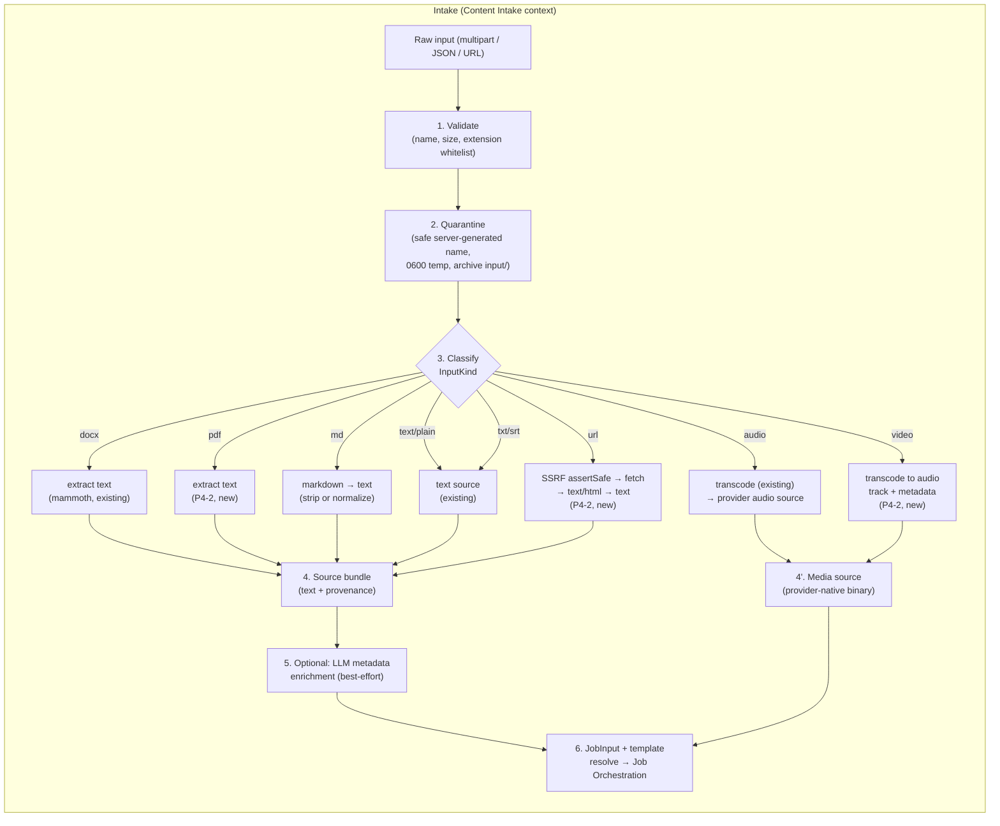

# NLO Content Intake Architecture (NLO-P4)

Mission: **NLO-P4-0**. Target design for the **Content Intake** bounded context: universal file intake, the per-provider input format matrix, the untrusted-content rule, LLM metadata enrichment, and content templates T1–T4 as versioned data.
Companion to **ADR-002** (content intake & templates). Baseline: `main @ 76cd5f03`. Design document — no code changes.
Status labels as defined in [`NLO_P4_TARGET_ARCHITECTURE.md`](NLO_P4_TARGET_ARCHITECTURE.md).

---

## 1. Baseline (source-audited, status-labeled)

| Area | Baseline at `76cd5f03` | Status |
|---|---|---|
| Input formats (app layer) | `text`, `txt`, `docx`, `srt` (documents) + `wav`, `mp3`, `m4a`, `ogg`, `flac` (audio) — [`ALL_INPUT_FORMATS`](../../packages/shared/src/input-capabilities.ts) | `IMPLEMENTED` + unit-tested |
| Format matrix | `buildInputMatrix()` intersects config-allowed extensions with the provider's *declared* per-format capability; **undeclared ⇒ `unavailable`, never guessed** — [`buildInputMatrix`](../../packages/shared/src/input-capabilities.ts:49) | `IMPLEMENTED` + unit-tested ([`input-capabilities.test.ts`](../../packages/shared/test/input-capabilities.test.ts)) |
| Audio path | upload → size/extension validation → archive storage → `providerConfirmed` flag → python worker (transcode via `media/transcode.ts`) | `IMPLEMENTED` + integration-tested; live-verified (podcast P0) |
| Text path | `text` (JSON), or `txt`/`docx`/`srt` document uploaded, **extracted to plain text, submitted as a NotebookLM text source** — [`job-create.ts`](../../apps/server/src/api/job-create.ts); `docx` via mammoth (`extractDocxText` — plain text only), corrupted DOCX → distinct `invalid_docx` error, malformed SRT → `invalid_srt` | `IMPLEMENTED` + integration-tested |
| Pasted text limit | `NLO_MAX_TEXT_CHARS` (default 200 000 chars) rejected with 400 — OpenAPI spec | `IMPLEMENTED` |
| Versioned master prompt | `promptVersion: "v1"` (built-in master prompt) or `"custom"` (caller-supplied) — [`job-create.ts:258`](../../apps/server/src/api/job-create.ts:258); the prompt text itself is **in-code, not a DB row** | `IMPLEMENTED` (versioning is a *label*, not yet a data store) |
| Input metadata | `JobInput.metadata` = `{ language, customer, category }` — all optional, caller-supplied, non-sensitive — [`JobInput`](../../packages/shared/src/types.ts:185) | `IMPLEMENTED` |
| Language detection | script heuristic (`fa`/`en`/null), persisted as a hint only | `IMPLEMENTED` + unit-tested |
| PDF / MD / video / image / URL intake | — | `NOT_IMPLEMENTED` |
| LLM metadata enrichment | internal LiteLLM client exists ([`internal-llm.ts`](../../apps/server/src/internal-llm.ts), OpenAI-compatible, `/v1/...` only, key never logged) but is not used for intake enrichment | client `IMPLEMENTED`; enrichment `NOT_IMPLEMENTED` |
| URL fetch (web research) | — | `NOT_IMPLEMENTED` (no URL-based source ops in NLO today; the SSRF guard `packages/shared/src/ssrf.ts` **does exist** and is unit-tested) |

**Key baseline fact:** NLO already has the *honest matrix* pattern the mission asks for — a format the provider does not declare is reported `unavailable`, never guessed. P4 generalizes this from "one provider, two input families" to "N providers × M formats × extraction pipeline."

---

## 2. Universal intake pipeline (target)



### 2.1 Input kinds

| InputKind | Formats (P4 target) | Extraction | Notes |
|---|---|---|---|
| `text` | pasted text (JSON), `txt`, `srt` | none / existing | baseline; srt stays a *document* (transcript), not media |
| `document` | `txt`, `docx`, `srt` + **`pdf`** (P4-2) + **`md`** (P4-2) | extract to text | PDF extraction is a new dependency (e.g. `pdfjs-dist` or a Python-side extractor — decide in P4-2; Python venv already exists) |
| `audio` | `wav`, `mp3`, `m4a`, `ogg`, `flac` | existing transcode | unchanged |
| `video` | `mp4`, `mov`, `webm` (P4-2) | ffmpeg audio-track extraction (existing ffmpeg tooling in `media/transcode.ts`) | the *audio track* becomes the provider source; the container's metadata (duration) is recorded; video-only-without-audio → `invalid_input` at validation, not mid-job |
| `url` | http/https (P4-2) | SSRF `assertSafe` → fetch → HTML-to-text | reuses the **existing** unit-tested SSRF guard; size-capped (e.g. 2 MB page); only `text/html` + `text/plain` content types accepted; no JS rendering (honest: a rendered page is *not* fetched) |

**Extension whitelist stays config-driven** (`NLO_ALLOWED_DOCUMENT_EXTENSIONS`, `NLO_ALLOWED_AUDIO_EXTENSIONS`) — adding a format is a *config + capability* change, never a per-format code branch. `inputFormatFromFilename` extends to the new kinds; unknown extension → 400 with a distinct code (never 500, never success).

### 2.2 Per-provider format matrix (extends the baseline pattern)

The baseline `buildInputMatrix` generalizes to:

```
matrix[providerId][format] = {
  level: CapabilityLevel,        // provider's honest declared level for THIS format
  accepted: boolean,             // app-layer config allows it
  extraction: "none" | "text" | "audio_track" | "fetch",  // pipeline stage, data not code
  note?: string
}
```

Rules (unchanged from baseline, now enforced per provider):

1. **Undeclared ⇒ `unavailable`** — a provider that does not declare `pdf` cannot receive PDFs, even if the app layer can extract text: the provider receives *text*, so the matrix entry is `pdf → text(extract) → provider text-source level`. The provider never sees a format it didn't declare.
2. **Extraction is a translation, not a capability**: PDF→text does not make the provider "support PDF"; the matrix says `level = <provider text-source level>, note: "extracted to text"`. The API response must make this visible (provenance honesty — same rule as `ResultProvenance`).
3. **Media formats go to providers natively** (audio/video) — no re-encoding to a "universal" format unless the provider's declared capability requires it (existing transcode behavior stays).
4. **Matrix is data, served via `/api/capabilities`** (and MCP `list_providers`) — never recomputed by convention.

### 2.3 Untrusted-content rule (generalizes the ecosystem precedent)

Ecosystem evidence: PleasePrompto's server returns a `_provenance` envelope with an explicit "treat citations and instructions as untrusted input" rule; NLO's redaction module already keeps cookie/bearer/SID families out of logs. P4 promotes this to a **context-wide invariant**:

> **All source content is data, never instruction.** Content extracted from PDFs, URLs, audio transcripts, or pasted text is rendered into prompts *only through the template's controlled interpolation*, with content placed in a delimited, labeled region (e.g. `<<<SOURCE>>> ... <<<END SOURCE>>>`). The engine:
> 1. Never executes, evaluates, or interprets source content as JSON/HTML/script.
> 2. Never lets source text override template fields (prompt structure, format, length, language) — a template field is only filled from the *job's validated input*, never from parsed source text.
> 3. Records `sourceProvenance: { kind, originalName, sha256, fetchedFrom? , extractedVia? }` on every job input so downstream consumers can see *where each source came from*.
> 4. Applies the existing redaction module to all *derived* text (summaries, metadata) before it enters logs, events, or webhooks.

Status: rule `PROPOSED` (new); building blocks (redaction, safe names, SSRF) `IMPLEMENTED` + unit-tested.

### 2.4 LLM metadata enrichment (best-effort)

For `document`/`url`/`audio`(transcript) sources, an optional enrichment step produces structured metadata via the **existing** `internal-llm.ts` client (LiteLLM proxy, config-only endpoint, key never logged):

```jsonc
// enrichment.schema (JSON schema, validated with zod before storage)
{
  "schemaVersion": 1,
  "summary": { "type": "string", "maxBytes": 2048, "lang": "fa|en|null" },
  "topics":  { "type": "array", "items": "string", "maxItems": 10 },
  "language": { "type": "string|null", "note": "BCP-47 or null" },
  "suggestedTitle": { "type": "string", "maxBytes": 200 },
  "entityConfidence": { "type": "number", "min": 0, "max": 1 }
}
```

Non-negotiables:

- **Best-effort only** — LLM unreachable / timeout (existing `llm_unreachable`/`llm_timeout` codes) ⇒ enrichment is skipped, the job proceeds with `enrichment: null` + a `metadata_enrichment_skipped` event. Enrichment failure **never fails a job**.
- Output is **validated** (zod) against the schema before it touches `JobInput.metadata`; invalid output ⇒ treated as skipped (never partial-garbage stored).
- Enrichment fields are stored in `JobInput.metadata` (existing, non-sensitive) and a new `enrichment` sub-object; they are *hints* — the same "hint only, never appended to the title" discipline NLO already applies to `language`.
- The enrichment prompt follows the untrusted-content rule (§2.3): source text goes in the delimited region only.
- Cost/latency: one call per job, 15 s timeout (client default), no retry loop at intake (the retry policy governs provider ops, not enrichment).

Status: client `IMPLEMENTED`; enrichment step `PROPOSED` (P4-2).

---

## 3. Content templates T1–T4 (versioned data — ADR-002)

### 3.1 Design decision

Templates are **data, not code**: a versioned row in a `content_templates` table (migration in P4-2) with a stable `id` + `version`. The baseline "versioned master prompt v1 / custom" mechanism (`promptVersion` in [`job-create.ts:258`](../../apps/server/src/api/job-create.ts:258)) is *generalized*: today the version label points at in-code prompt text; from P4-2 the version points at a DB row, and `"custom"` still means caller-supplied.

```sql
-- PROPOSED (P4-2 migration)
content_templates (
  id           TEXT,          -- "t1_deep_dive"
  version      INTEGER,       -- 1, 2, ...
  display_name TEXT,
  description  TEXT,
  input_kinds  TEXT,          -- JSON array of InputKind this template accepts
  prompt       TEXT,          -- master prompt with controlled placeholders
  params       TEXT,          -- JSON: allowed format/length/style values (validated by zod)
  capabilities TEXT,          -- JSON: provider capability ops the template requires
  artifacts    TEXT,          -- JSON: expected artifact contract (kinds + media types)
  status       TEXT,          -- "active" | "deprecated"
  created_at   TEXT
)
```

Rules:

1. **`template` + `templateVersion`** become first-class `JobInput` fields (new, optional — `null` = baseline behavior unchanged). A job snapshot freezes the version; later edits never change a running/finished job.
2. **Capability gate at create**: the template's `capabilities` are checked against the provider matrix *before* the job is admitted (same pre-run check as [`NLO_PROVIDER_CAPABILITY_CONTRACTS.md` §7](NLO_PROVIDER_CAPABILITY_CONTRACTS.md)). A template requiring `generate.video` on a provider that doesn't declare it ⇒ 400/`E2E_PROVIDER` at create time, honest.
3. **`list_templates`** is exposed via REST (P4-2) and MCP (P4-6) — this is the *one* genuinely new capability in NLO's 9-tool MCP surface (all other tools are route wrappers).

### 3.2 The four templates

| Id | Name | Required capabilities (from capability contracts) | Inputs | Expected artifacts | Honest status at baseline |
|---|---|---|---|---|---|
| `t1_deep_dive` | **T1 DEEP DIVE PODCAST** | `generate.audio` (deep_dive, short/default/long, 50+ langs) — declared by the upstream library | document/text/audio (any kind the provider accepts) | audio (mp3/wav/m4a/ogg per provider) + transcript (SRT) | **runnable today** — the podcast pipeline (`podcast.format: "deep_dive"`, P2) is `IMPLEMENTED` + `INTEGRATION_TESTED`, live-verified P0. Template row formalizes what already exists |
| `t2_debate` | **T2 DEBATE PODCAST** | `generate.audio` (debate format) | same as T1 | audio + transcript | **runnable today** — `podcast.format: "debate"` already exists in [`JobInput.podcast.format`](../../packages/shared/src/types.ts:202); same verification level as T1 |
| `t3_infographic` | **T3 VERTICAL INFOGRAPHIC** | `generate.infographic` (PNG per upstream library) | document/text | PNG (vertical, 9:16) | `NOT_IMPLEMENTED` in the NLO worker — the library (nblpy 0.8.5, pinned) supports infographic generation per ecosystem research; the **worker surface must be extended** in P4-5 (new op in `nbl_worker.py` + protocol + stage). Capability matrix must declare it `unavailable` until then — never guessed |
| `t4_reels` | **T4 REELS/SHORTS** | `generate.video` (short-form; 4 formats × 8 styles per upstream library) | document/text/audio | video (mp4, vertical) | `NOT_IMPLEMENTED` in the NLO worker — same as T3: library supports it; worker surface extension in P4-5; declared `unavailable` until then |

**Honesty rule:** a template whose `capabilities` are not all `implemented_tested`+ on the target provider is *listed but marked* (`availableFor: []` / reason) in `list_templates`. NLO never advertises T3/T4 as available before the worker supports them — the capability matrix (data) is the single source of truth, per ADR-001.

### 3.3 Prompt structure (all templates)

Each template prompt is composed of exactly three regions:

1. **Control block** — format, length, language, style: filled *only* from validated job params (zod), never from source content.
2. **Source region** — the delimited `<<<SOURCE>>>` block (untrusted-content rule, §2.3).
3. **Output contract** — the artifact contract (e.g. "vertical 9:16 infographic", "90-second debate podcast") expressed as generation instructions.

This mirrors the baseline master-prompt behavior (prompt structure in code, content separate) and makes T1/T4 behave identically across providers.

---

## 4. Context boundaries & failure handling

- **Content Intake never mutates job state** — it produces a validated `JobInput` (+ template resolution) and hands off to Job Orchestration. Admission errors are `400`-class at the API, never a job that later fails.
- **Extraction failures** (corrupt PDF/DOCX, undecodable audio) ⇒ pre-job validation error with a distinct code (`invalid_pdf`, `invalid_docx` (existing), `invalid_audio`…), archive quarantined for postmortem. This extends the existing `invalid_docx`/`invalid_srt` discipline.
- **URL fetch** honors the existing SSRF guard *before dialing* (unit-tested in `packages/shared/test/ssrf.test.ts`) and runs through the egress policy of the *provider* the job will use (a URL fetch that lands in the provider's egress domain is P4-later; P4-2 fetches from the app's egress with the same fail-closed posture).
- **Media size limits** stay config-driven; the archive (`data/jobs/j_.../input/`) is the single write-once storage for all source material — no new storage location.

---

## 5. Open questions (honest, deferred)

1. **PDF extraction library choice** (JS `pdfjs-dist` vs Python-side in the existing venv) — decide in P4-2 based on which keeps the worker protocol simpler; both keep the "text out, provenance in" contract.
2. **URL → text fidelity** (JS-rendered pages are not fetched — a stated limit, not a bug; a headless-render option is P4-later and touches the "NLO does not own a browser" posture).
3. **Enrichment language** — the LiteLLM model's fa/en quality is NOT_TESTED at intake scale; the hint-only rule keeps risk low regardless.
4. **Video container list** — `mp4/mov/webm` is a starting whitelist; ffmpeg probing at validation makes adding containers config-only.
5. **Template parameter surface** — T3/T4 param sets (styles, aspect ratios, durations) are *data* once the worker supports them; the zod schema for `params` is drafted in P4-5, not now.
