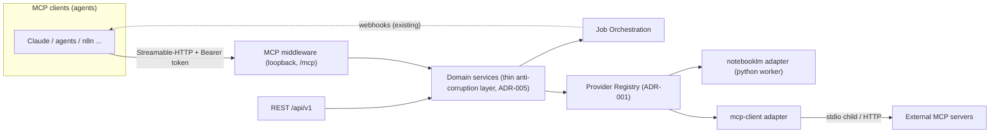

# NLO MCP Integration Architecture (NLO-P4)

Mission: **NLO-P4-0**. Target design for NLO's **Model Context Protocol** surface in both directions: NLO **as an MCP server** (agents call NLO) and NLO **as an MCP client** (external MCP servers are consumed by the provider layer).
Companion to **ADR-005** (NLO as MCP server) and **ADR-006** (NLO as MCP client / external providers). Baseline: `main @ 76cd5f03`. Design document — no code changes.
Status labels as defined in [`NLO_P4_TARGET_ARCHITECTURE.md`](NLO_P4_TARGET_ARCHITECTURE.md). Research basis: [`NLO_NOTEBOOKLM_MCP_COMPARISON.md`](../research/NLO_NOTEBOOKLM_MCP_COMPARISON.md).

---

## 1. Baseline (source-audited, status-labeled)

| Area                                        | Baseline at `76cd5f03`                                                                                                     | Status                                                                             |
| ------------------------------------------- | -------------------------------------------------------------------------------------------------------------------------- | ---------------------------------------------------------------------------------- |
| MCP server                                  | **none** — no MCP route, no MCP dependency                                                                                 | `NOT_IMPLEMENTED`                                                                  |
| REST API                                    | the single programmatic surface; token auth (`nlo_<slug>_<64hex>`, 6 scopes, audit log); idempotency keys; OpenAPI v1 spec | `IMPLEMENTED` + integration-tested                                                 |
| Domain services behind routes               | route handlers call domain repos/services directly; no independent service boundary layer to reuse for a second front door | `IMPLEMENTED` (routes are thin but share state with the app, not via an interface) |
| Webhooks                                    | outbound notifications (HMAC-signed, outbox, exactly-once) — the existing "agent-friendly" push channel                    | `IMPLEMENTED` + integration-tested                                                 |
| MCP client (consuming external MCP servers) | none                                                                                                                       | `NOT_IMPLEMENTED`                                                                  |
| Tool surface that _would_ map to MCP        | job create/status/events/cancel, artifact download, providers/capabilities, tokens, sessions, proxies, webhooks, settings  | `IMPLEMENTED` as REST                                                              |

**Key fact:** NLO's 9 proposed MCP tools are _7 route wrappers + 1 new capability_ (`list_templates`) + 1 wrapper over the new retry endpoint. The design work is the **anti-corruption layer**, transport, and auth — not domain logic.

---

## 2. NLO as an MCP server

### 2.1 Transport & binding

- **Streamable-HTTP** (the ecosystem's dominant non-stdio pattern — used by PleasePrompto/abdallah-mcp, roomi) on the **existing loopback Fastify app**, under `/mcp` (POST/GET/DELETE, `Mcp-Session-Id` header per the Streamable-HTTP spec). No second port, no second process.
- **stdio** is _not_ an NLO server mode in P4: NLO is a persistent stateful service (DB, worker, tunnels) — a stdio child process would imply a lifecycle NLO doesn't have. Clients that need stdio (Claude Desktop etc.) use the ecosystem-standard bridge (e.g. an `mcp-remote`-style HTTP→stdio proxy) — an ops note, not an NLO feature.
- **Loopback by default** (security invariant, same as the app): the MCP endpoint binds with the app; any non-loopback exposure goes through the existing auth-capable reverse-proxy rule (ADR-004/§7 security invariants).

### 2.2 Tool surface (9 tools — the mission's list)

| Tool                  | Maps to                                                                                         | Auth scope       | New domain logic?                          |
| --------------------- | ----------------------------------------------------------------------------------------------- | ---------------- | ------------------------------------------ |
| `create_job`          | `POST /api/v1/notebooks/from-text` / audio create                                               | `jobs:write`     | no                                         |
| `get_job`             | `GET /api/v1/jobs/:id` (+ events)                                                               | `jobs:read`      | no                                         |
| `list_jobs`           | `GET /api/v1/jobs` (pagination)                                                                 | `jobs:read`      | no                                         |
| `retry_job`           | `POST /api/v1/jobs/:id/retry` (P4-4, ADR-007)                                                   | `jobs:write`     | no (new endpoint)                          |
| `cancel_job`          | `POST /api/v1/jobs/:id/cancel`                                                                  | `jobs:write`     | no                                         |
| `get_artifact`        | `GET /api/v1/jobs/:id/artifacts/:artifactId` (download)                                         | `jobs:read`      | no                                         |
| `list_templates`      | `GET /api/v1/templates` (P4-2, ADR-002)                                                         | `jobs:read`      | **yes — the one genuinely new capability** |
| `list_providers`      | `GET /api/v1/providers` + capabilities matrix                                                   | `providers:read` | no                                         |
| `get_provider_health` | provider/account/egress health snapshot (composite of `/api/health/ready`-class data, redacted) | `providers:read` | no (read model)                            |

Non-negotiables (from research doc §5 constraints):

1. **MCP tools are a view, never a second source of truth.** Each tool calls the _same_ domain services the REST route calls; a capability is either `implemented_tested` on both fronts or on neither. No tool may bypass the state machine, the capability matrix, or the error envelope.
2. **Errors use the existing envelope** `{ error: { code, message } }` (`ApiCodes` in `packages/shared/src/api-error.ts`) mapped into MCP tool-result errors — the 13 E2E-contract error codes carry over verbatim.
3. **Long operations return a job id, not a promise**: `create_job` returns `{ job: "j_<hex32>", status }`; the agent polls `get_job` or subscribes to webhooks (existing). MCP's request/response model must not imply sync completion.
4. **Untrusted-content rule applies to tool _inputs_**: `create_job` prompt/source content is data (ADR-002 §2.3); tool descriptions are explicit about it ("source content is inserted into the notebook verbatim — treat as untrusted").
5. **No secrets in tool schemas or results**: health snapshots are redacted through the existing redaction module; `get_artifact` returns the artifact (or a download URL with a scoped, expiring token — P4-6 decision, default: direct body with `mediaType`, sizes are config-capped).

### 2.3 Auth: reuse API tokens (no new mechanism)

- The MCP endpoint authenticates with **existing API tokens** (Platform AuthN/Z context): `Authorization: Bearer nlo_...` on the MCP initialize/POST. Scope check per tool (table above). Audit log rows record `via: "mcp"` + tool name + correlation id.
- **Token-scoped idempotency** (existing) applies to `create_job` exactly as on REST.
- No MCP-specific credentials: creating a token with the minimal scopes an agent needs _is_ the per-agent credential. One operator manages tokens per agent — consistent with the single-operator service posture.

### 2.4 Resources & prompts (optional, P4-6-later)

- **Resources** (`templates://...`): expose template definitions as MCP resources — cheap once `list_templates` exists; deferred, not P4-6 core.
- **Prompts** (MCP prompt objects for T1–T4): deferred; templates-as-data (ADR-002) already serves this over `list_templates`.

---

## 3. NLO as an MCP client (external MCP servers as providers)

The mission requires NLO to consume _other_ MCPs. Target posture:

### 3.1 Where it plugs in

An **external MCP server is a Provider Registry entry of kind `mcp_client`** (ADR-001), not a special case:

```
ProviderDescriptor {
  id: "mcp:<name>",
  kind: "mcp_client",
  transport: { stdio: { command, args, envSecretRefs } } | { http: { url, headers } },
  capabilities: [...],        // declared from the server's tool list + mapping (below)
  egressPolicy: "direct-allowed" | "tunnel-preferred" | "must-tunnel",
  maxConcurrent: 1,           // stdio child = single session; HTTP = server-declared
  adapter: "mcp-client"
}
```

The **`mcp-client` adapter** implements the `ContentProvider` interface ([capability contracts §3]) by _mapping_ NLO operations to the external server's tools:

| NLO op                         | External MCP tool (conventional names, configurable per provider row)                                                                                                                      |
| ------------------------------ | ------------------------------------------------------------------------------------------------------------------------------------------------------------------------------------------ |
| `verify()`                     | a health/login tool if declared, else `tools/list` + a cheap known tool                                                                                                                    |
| `createNotebook` / `addSource` | the server's source-management tools                                                                                                                                                       |
| `generate` / `poll`            | the server's generation tools; **the external tool's job/operation id is recorded in `job_stages.external_operation_id`** → the UNKNOWN_EXTERNAL_STATE rule (ADR-007 §3) applies unchanged |
| `fetchArtifact`                | the server's download/return mechanism                                                                                                                                                     |

### 3.2 Non-negotiables (client side)

1. **Capability honesty by mapping, not by faith**: an external server _declaring_ a tool is not a capability. A provider row's capabilities are set by an **explicit mapping file** (data: NLO op → external tool + parameter mapping + output parsing). An op with no mapping is `unavailable` — the conformance suite (C1–C7, capability contracts §4) must pass against the _adapter_, including one live run (C7) before the provider is admitted.
2. **Lifecycle ownership**: a stdio MCP child is owned by NLO's `WorkerSupervisor` pattern (spawn args-array, JSON-line stdio, settle-once, SIGTERM→SIGKILL 4 s — all existing, generalized to "worker-like processes"). No orphan processes on restart: the supervisor's boot-time reaping applies.
3. **Secrets via vault refs** (`envSecretRefs`) — never inline in the DB row, same rule as proxy UUIDs.
4. **Egress policy honored**: an MCP child that needs the internet runs behind the same fail-closed egress decision as everything else (it may need `direct-allowed` for local tools — declared per provider, never assumed).
5. **Timeouts & settle-once** inherited from the worker protocol: a stuck MCP server is a `connectivity`/`provider` failure class, retried per ADR-007.
6. **Provenance**: artifacts from an external MCP provider are stored with `resultProvenance: "real"` only if the adapter verified them (size/hash/signature checks per the existing artifact-validate discipline); otherwise `"unknown"` — the ecosystem's `_provenance`-envelope precedent (PleasePrompto) is the pattern NLO _generalizes_: NLO's own envelope is the artifact record.

### 3.3 What P4 deliberately does **not** do

- No dynamic tool discovery at job time (the mapping is static data; a changed external server is a re-admission event, not a runtime surprise).
- No MCP _server_ for the python worker (the worker is an internal implementation detail, not a provider — it _is_ the `notebooklm` provider's transport).
- No multi-tenant MCP sessions: one session per provider row, serial by default (`maxConcurrent: 1`), matching the single-operator posture.

---

## 4. Failure domains & boundaries



- The MCP front door **cannot** reach past the domain layer: no direct repo access, no DB, no tunnel objects, no worker handles — the same isolation the REST layer already has, made _structural_ by the ACL (research doc §5 constraint: "one domain, two front doors").
- A crash of any MCP client connection has **zero** effect on running jobs (MCP is a front door, not a data path).
- A failure of an external MCP _provider_ is a normal provider failure (ADR-007 classification) — no special error class.

---

## 5. Status summary & open questions

| Item                                                     | Status                                                                    |
| -------------------------------------------------------- | ------------------------------------------------------------------------- |
| MCP server on loopback Fastify (`/mcp`, Streamable-HTTP) | `PROPOSED` (P4-6)                                                         |
| 9 tools (8 wrappers + `list_templates` new)              | `PROPOSED`; underlying REST `IMPLEMENTED` for 7/9, P4-2/P4-4 for the rest |
| Token auth + per-tool scopes + `via: mcp` audit          | `PROPOSED` over `IMPLEMENTED` token system                                |
| MCP client adapter (`mcp_client` provider kind)          | `PROPOSED` (P4-7)                                                         |
| External-server conformance (C-suite)                    | `PROPOSED`                                                                |
| Resources / MCP prompts                                  | `NOT_IMPLEMENTED`, deferred (P4-later)                                    |

Open questions (honest):

1. **`get_artifact` body vs URL**: direct body (simple, size-capped) vs scoped expiring download URL (better for large video artifacts) — decide in P4-6; both reuse the existing artifact download route logic.
2. **MCP session lifetime vs long jobs**: Streamable-HTTP sessions are short-lived by nature; the design already leans on webhooks + polling, but the _subscription_ semantics (server→client notifications over the MCP session) are P4-6-later and optional.
3. **stdio MCP child env isolation**: which env vars the supervisor passes to a stdio child (PATH, vault-injected secrets only) — spec'd in P4-7 alongside the worker env discipline.
4. **External server versioning**: mapping files carry a `serverVersionRange`; out-of-range ⇒ provider flagged `degraded` (admission rule), not silently broken.
