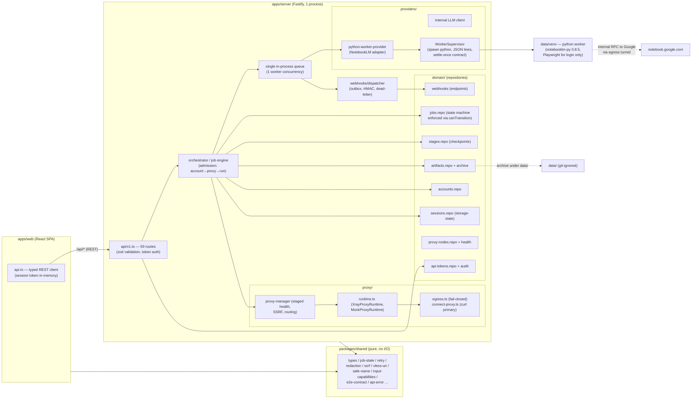
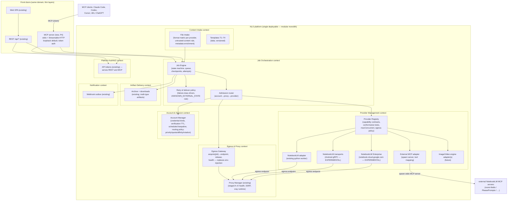

# NLO-P4 — Target Architecture (Modular Platform)

Mission: **NLO-P4-0 — Universal Modular Architecture & NotebookLM Ecosystem Discovery**
Baseline: `main @ 76cd5f03` (2026-11-15). This document **designs** the target state; it changes no code.
Status labels: `IMPLEMENTED` (code + tests at baseline) · `CODE_VERIFIED` (read at baseline, not independently re-tested here) · `UNIT_TESTED` · `INTEGRATION_TESTED` · `LIVE_VERIFIED` · `PARTIAL` · `EXPERIMENTAL` · `NOT_IMPLEMENTED` (P4 target) · `BLOCKED` · `NOT_TESTED`.

---

## 1. What NLO is today (audit summary, evidence-backed)

**Shape:** npm-workspaces monorepo — `packages/shared` (domain types + pure logic, 13 exports), `apps/server` (Fastify + `node:sqlite` + tsx, in-process single-worker queue + per-job Python worker spawns), `apps/web` (Vite/React SPA, 7 routes). **Modular monolith** — one deployable, clear internal module boundaries, single DB, single process for the API+queue.

| Capability | Status (evidence) |
|---|---|
| Job state machine (12 statuses, `canTransition` enforced at repo layer) | `IMPLEMENTED` / `UNIT_TESTED` ([`packages/shared/src/job-state.ts`](../../packages/shared/src/job-state.ts), [`apps/server/src/domain/jobs.repo.ts`](../../apps/server/src/domain/jobs.repo.ts)) |
| Job persistence + provenance (notebook_id, operation_ids_json, result_provenance, node_id, attempt log) | `IMPLEMENTED` / `INTEGRATION_TESTED` (migrations 0001–0002; job-lifecycle.test.ts) |
| Resume-never-resubmit podcast pipeline (external task id persisted pre-poll; `job_stages` checkpoints survive restart) | `IMPLEMENTED` / `LIVE_VERIFIED` 2026-11-06 (CHANGELOG NLO-P2; podcast-fault-recovery.test.ts) |
| Provider abstraction with honest capability levels + `ProviderFailure` (8 failure classes, ambiguous = never auto-retried) | `IMPLEMENTED` / `UNIT_TESTED` ([`packages/shared/src/types.ts`](../../packages/shared/src/types.ts), python-worker-provider.ts) |
| Fail-closed proxy layer (xray/VLESS, staged A–E health, SSRF guard, curl-primary transport, 10-min TTL, per-job node attribution) | `IMPLEMENTED` / `INTEGRATION_TESTED` (MockProxyRuntime 6 scenarios) + `LIVE_VERIFIED` (production 172.30.0.133) |
| Google account sessions (per-account Playwright storage-state 0600, 9-state machine, 10-min verified TTL, reauth) | `IMPLEMENTED` / `LIVE_VERIFIED` |
| API tokens (SHA-256 hash, 6 scopes, idempotency, audit log), webhooks (outbox, exactly-once settlement, HMAC, dead-letter) | `IMPLEMENTED` / `INTEGRATION_TESTED` |
| Artifact archive (per-job layout, sha256, ETag download, MP3 transcode), redaction, vault (AES-256-GCM) | `IMPLEMENTED` / `INTEGRATION_TESTED` |
| CI (lint/format/typecheck/test/build, Node 22; docker smoke) + manual live gate | `IMPLEMENTED` (`.github/workflows/ci.yml`) |
| MCP client or server | `NOT_IMPLEMENTED` (P4 target) |
| Multi-content-engine (video/infographic/image), multi-transport provider (Android gRPC, Enterprise host, external MCP), multi-account rotation, universal intake (PDF/MD/video), templates T1–T4 | `NOT_IMPLEMENTED` (P4 targets) |

**The single biggest structural fact:** NLO already *is* most of the modular platform — the module boundaries (domain / providers / proxy / webhooks / shared) exist and are tested. P4 is **boundary-hardening + new adapters + new contexts**, not a rewrite. Per AGENTS.md §1.3, nothing working is rewritten without a test and a stated technical reason.

## 2. Current dependency map (Mermaid, from the source audit)

**Coupling findings (audit):**
1. **Healthy:** `shared` is a leaf (no I/O); every module depends down; web → server only via REST; worker → server only via stdio protocol.
2. **Known coupling (P4 targets):**
   - **Egress injected as env into the worker** (`tunnelEnv`) — egress decision buried inside provider invocation; node switch requires restart (→ Egress Gateway, §4).
   - **Provider chosen by construction** (a single `python-worker-provider` is wired at boot) — no registry, no per-job provider selection (→ Provider Registry, §4).
   - **Account choice is a request hint** (`preferredAccountId`) resolved ad-hoc — no routing policy (quota, affinity, rotation) (→ Account Manager, §4).
   - **Input formats are a static list** (`input-capabilities.ts`) tied to the current provider — no per-provider matrix in the job contract (→ universal intake, §4).
   - **No MCP surface** (client or server).

## 3. Target context map (DDD view)

The mission proposed 12 bounded contexts; verified against source, the honest map is **8 contexts now** (3 of the proposed 12 are sub-concerns of existing contexts, 1 is a P4-later concern):

| # | Context | Baseline evidence | P4 delta |
|---|---|---|---|
| 1 | **Job Orchestration** (state machine, queue, stages, attempts, events, idempotency) | `IMPLEMENTED` (jobs.repo, stages.repo, job-state) | retry-from-checkpoint API; cross-provider job records |
| 2 | **Provider Management** (capability contracts, adapters, conformance) | `PARTIAL` (one adapter, capability levels) | Provider Registry + conformance suite (ADR-001) |
| 3 | **Account & Session** (Google accounts, credential kinds, verification TTL, reauth, keepalive) | `IMPLEMENTED` (sessions, accounts, auth_sessions 9-state) | credential kinds (master token, enterprise), scheduled keepalive, routing policy (ADR-003) |
| 4 | **Egress & Proxy** (node registry, runtime, staged health, fail-closed transport) | `IMPLEMENTED` (proxy/*) | Egress Gateway interface, per-provider egress policy, account↔node affinity (ADR-004) |
| 5 | **Content Intake** (upload, validation, format matrix, text extraction, untrusted-content rule, metadata) | `IMPLEMENTED` (audio/text + capabilities) | universal formats (PDF/MD/video), LLM metadata enrichment (ADR-002 spec) |
| 6 | **Artifact Delivery** (archive, storage meta, download, transcode, provenance) | `IMPLEMENTED` (artifacts.repo, archive.ts) | multi-artifact types (video/infographic/image), per-template artifact contracts |
| 7 | **Notification** (webhook outbox, HMAC, delivery states) | `IMPLEMENTED` (dispatcher) | no change (consumes job/provider events) |
| 8 | **Platform AuthN/Z** (API tokens, scopes, audit, session admin) | `IMPLEMENTED` (api-tokens.repo) | MCP server reuses tokens; no new mechanism |
| — | *Proposed but folded:* "Template Management" → sub-context of Content Intake (templates are intake+prompt presets, not a separate context) | — | T1–T4 as data (ADR-002) |
| — | *Proposed but folded:* "Retry & Failover" → cross-cutting policy of Job Orchestration + Provider Mgmt | — | failure-class-driven policy (ADR-007) |
| — | *Proposed, deferred:* "Billing/Usage" | usage introspection exists in ecosystem, not in NLO | P4+ (metering per account) — out of P4 scope |
| — | *Proposed, deferred:* "Observability" (traces/metrics) | correlation ids exist; no metrics | P4+ — out of scope, keep correlation ids |

Context communication rules (enforced by the boundaries above):
- Only **Job Orchestration** calls Provider Management (via the registry).
- Only **Job Orchestration** asks Account/Egress contexts for resources (admission: `WAITING_FOR_ACCOUNT` → `WAITING_FOR_PROXY` → `RUNNING`).
- **Artifact Delivery** and **Notification** react to job events; they never mutate job state.
- The **REST API and MCP server** are both *thin anti-corruption layers* over the same domain services — one domain, two front doors (ADR-005).

## 4. Target architecture (component view)

### 4.1 Architectural decisions (summary; full rationale in ADRs 001–007)

| ADR | Decision |
|---|---|
| 001 | **Modular architecture** — the modular monolith stays (no microservices; in-process contexts + shared kernel; microservices exit criteria defined) with the **Provider Registry** as its core mechanism: every content engine is an adapter behind a capability contract + conformance tests; capability levels stay honest (no inflation) |
| 002 | **Content Intake as context** — format matrix per provider, untrusted-content rule, templates as *data* (T1–T4), LLM metadata enrichment |
| 003 | **Account Manager owns credentials** — credential kinds (storage-state / master-token / enterprise-SSO), scheduled keepalive, routing policy (priority → quota → affinity → rotation) |
| 004 | **Egress Gateway** — egress becomes a platform service (acquire/release/health); per-provider egress policy; fail-closed semantics preserved; account↔node affinity |
| 005 | **NLO as MCP server** — 9 tools as a thin anti-corruption layer over the domain services (7 route wrappers + `list_templates`); API-token auth; loopback Streamable-HTTP; errors via the existing envelope |
| 006 | **NLO as MCP client** — external MCP servers admitted to the Provider Registry as `mcp_client` providers; static op→tool mapping; conformance (C1–C7) before admission; provenance envelope on artifacts |
| 007 | **Retry & failover policy** — failure-class driven (existing RETRYABLE map), UNKNOWN_EXTERNAL_STATE = never blind-resubmit; provider failover only for *Unavailable* (never for *Operation Failed / Outcome Unknown*); retry-from-last-safe-checkpoint |

### 4.2 What explicitly does NOT change (non-goals, protected)

- Job state machine semantics and transition rules (only *new statuses* may be added, backward-compatible).
- Fail-closed egress: no `direct` mode without explicit operator opt-out; curl-primary transport.
- Hash-only API tokens; vault-based secrets; redaction everywhere; loopback-only bind default.
- The Python worker protocol (arg-array spawn, JSON lines, settle-once) — adapters reuse it.
- `data/` layout and git-ignored runtime data.
- CI structure (live gate stays manual).

## 5. Build-vs-adopt per capability

| Capability | Build | Adopt | Evidence / note |
|---|---|---|---|
| Job engine, checkpoints, attempts | Build (existing) | — | strongest asset in the ecosystem; keep |
| NotebookLM web transport | Build (existing) | — | notebooklm-py in worker |
| Cookie-free transport (Android gRPC, master token) | Build thin adapter | notebooklm-py backend | `EXPERIMENTAL` upstream; dedicated account required |
| Enterprise host | Build thin adapter | jacob-bd's host/config model | `EXPERIMENTAL`; live-verify with a real GCP project before claiming |
| Multi-account rotation | Build policy | roomi-fields pattern | routing-layer policy, not inside adapters |
| External MCP as provider | Build generic client adapter | stdio JSON-RPC | per-server capability declaration |
| Image/video engines | Build adapters later | ecosystem MCP servers | no first-party API exists; MCP servers are the only current access |
| Webhooks, tokens, archive, redaction | Build (existing) | — | already ahead of the ecosystem |
| Browser login | — | Playwright (existing) | browser only for *login*, never at request time |

## 6. Scale & deployment posture (P4)

- **Deployment unchanged:** systemd service `nlo`, git-based `deploy/deploy.sh`, DB in `data/`, Docker for local single-user. Microservices are *not* on the P4 path (ADR-001) — the in-process queue with a single worker concurrency is a deliberate choice for a single-operator service; the design keeps the queue interface so a process-boundary split is a later, low-risk move.
- **Concurrency growth path:** (1) keep single worker (P4-1), (2) N in-process workers sharing the DB queue with per-provider `maxConcurrent` (P4-later), (3) separate queue process (only if (2) is insufficient). Each step is gated by the four-path acceptance matrix.
- **Data growth:** job archives under `data/jobs/` are append-only per job; retention/cleanup is an operations concern (runbook), not an architecture change.

## 7. Migration path from baseline to target (no big bang)

1. **P4-1 Foundations:** Provider Registry interface + move the existing python-worker-provider behind it (pure refactor, conformance suite green before/after); Egress Gateway interface over the existing proxy manager (env-injection removed).
2. **P4-2 Intake & Templates:** universal format matrix, untrusted-content rule, T1–T4 as data, metadata enrichment.
3. **P4-3 Accounts & Egress policy:** credential kinds, scheduled keepalive, routing policy (priority/quota/affinity/rotation), per-provider egress policy.
4. **P4-4 Retry & failover:** retry-from-checkpoint API, checkpoints + recheck, UNKNOWN_EXTERNAL_STATE enforcement, provider failover for Unavailable (node/account), events + webhooks.
5. **P4-5 Content engines (T3/T4):** worker ops for vertical infographic + reels/shorts video (nblpy surface extension), new artifact types, multi-artifact delivery.
6. **P4-6 MCP server:** 9 tools, Streamable-HTTP on the existing loopback Fastify, per-tool scopes, provenance envelope, four-path reference scenario.
7. **P4-7 MCP client & new transports:** external-MCP client adapter (`mcp_client` provider kind), Android-gRPC transport adapter, Enterprise-host adapter (each live-verified before enablement).
8. **P4-8 Hardening:** four-path acceptance matrix green (UI/REST/MCP/External E2E), docs, runbooks, live gates.

Each step: tests + docs + CHANGELOG + commit; nothing ships untested (AGENTS.md §3, §5).
