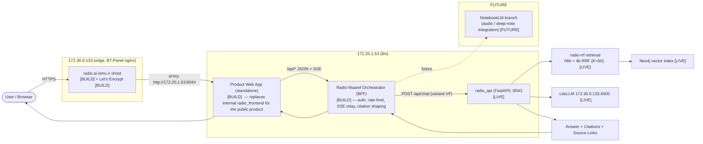

# RADIO R0 — Radio Maaref: Infrastructure Discovery & Domain Launch Readiness

> **Mission:** R0 (read-only discovery) for the independent product **رادیو معارف / Radio Maaref**,
> target domain **`https://radio.ai.ismc.ir`**.
> **Performed:** 2026-11-10 (Asia/Tehran) · **Mode:** STRICTLY READ-ONLY.
> **Safety:** No DNS, Nginx, certificate, service, repository, commit, push, deploy, or
> production change was made. No resource-consuming `POST /api/chat` was issued without
> approval. **No secrets, tokens, cookies, UUIDs, or private keys are printed in this report.**
> **Verification levels** are labeled honestly: `VERIFIED` (live-observed), `PARTIALLY VERIFIED`,
> `NOT IMPLEMENTED`, `BLOCKED` (needs a credential we do not hold), `UNKNOWN`.

---

## 1. Executive Summary

Radio Maaref already has a **working, live RAG answer engine** on the internal network:
`radio_api` (FastAPI) + `radio_frontend` (Persian SPA) running in Docker on **`172.20.1.53`
("llm")**, backed by **Neo4j** (vector index `vector_index_chunk`) and **LiteLLM** on
`172.30.0.133:4000`. The engine supports four retrieval variants — `radio` / `radio-06b`
(default) / `radio-4b` / **`radio-rrf`** — and the selected **`radio-rrf`** variant is **present
in the live code** and **selectable via `POST /api/chat` with `variant="rrf"`**, scoring
**92/100** in the last live benchmark (2026-11-06).

**What blocks the product from living on `radio.ai.ismc.ir` today is purely the edge + product
layer, not the engine:**

- The **edge vhost is not installed** on `172.30.0.133`. Today `https://radio.ai.ismc.ir` is
  caught by the **default CMS vhost** and 307-redirects to `/login`; TLS serves the
  `admin.ai.ismc.ir` default certificate, **not** a `radio.ai.ismc.ir` certificate.
- There is **no product Orchestrator** (BFF) and **no standalone product Web App** — only the
  internal `radio_frontend` on `53:8044`.
- The **`radio-rrf` leg has a citation-quality gap:** ~44% of RRF citations lack a source URL
  (the `4b` leg / linkage stage K1–K22 was not run on the `radio-4b` Neo4j database).

**Verdict (summary):** the domain **can** be brought up safely and quickly. The fastest real MVP
path is: (1) install the already-drafted edge vhost + Let's Encrypt on `133`, (2) build a thin
**Orchestrator** that calls the live `radio_api` with `variant="rrf"`, (3) serve a product
**Web App** from the vhost. The engine, Docker, API, Swagger, and backend are already live and
verified. Details and the full readiness table are in §14.

---

## 2. Repository Inventory (local + server52and53 + live server)

### 2.1 Live production repository (the engine that matters)

| Attribute | Value (VERIFIED via SSH `saber@172.20.1.53`) |
| --- | --- |
| Working dir | `/home/saber/saberprojects/radio-rag-service` |
| Remote `origin` | `https://git.ai.ismc.ir/rag/radio-rag-service.git` (internal GitLab) |
| Branch | `stage5-citations` |
| HEAD | `71d94d1 feat(citations): Stage 5 structured citations + clickable frontend links (spec §9)` |
| Push state | in sync with origin (pushed) |
| Working tree | clean, **1 untracked file**: `tests_test_citation_quality.py` |
| Docker compose file | `docker-compose.radio.yml` |
| Env file | `.env.radio` |

### 2.2 Local snapshots on this workstation (`..\server52and53`)

| Path | What it is | Key facts |
| --- | --- | --- |
| `_work\stage5_repo\radio-rag-service\api.py` | **LIVE Stage-5 API code** (36,257 bytes) | SHA256 `4258985270DE662A7BF78F607E1B60810809C5716F2A37F88A4E95D08D0A960C` — **matches the live-verified `/app/app/api.py` hash** (live since 2026-11-06) |
| `_work\stage5_repo\live-radio-api\api.py` | Older API snapshot (29,426 bytes) | Diff vs the Stage-5 file = the Stage 5 additions (citations, `dedup_sources()`, URL fields, `citations[]` in `ChatResponse`) |
| `_work\stage5_repo\live-radio-frontend\` | Frontend snapshot | `index.html` (Persian RTL SPA, `__META_*__` template vars, canonical `https://radio.ai.ismc.ir`, variant selector 4b/06b), `app.js`, `style.css` |
| `repo\docs\RADIO_PHASE_A_FINAL_REPORT.md` | Corpus rebuild report | 4,148 docs / 79,350 chunks; two validated dumps; import to Neo4j **awaiting approval** |
| `repo\docs\radio_migration_2026-11-05.md` | Corpus migration history | Adapter design, build steps, decisions |
| `repo\RADIO_PHASE_A_CHECKPOINT.md` | Build checkpoint | dump paths, regenerate + validation commands |
| `edge_vhost_radio.ai.ismc.ir.conf` | **Planned (NOT deployed)** BT-Panel vhost for `133` | HTTP→HTTPS redirect, ACME challenge, proxies to `http://172.20.1.53:8044` with SSE settings (`proxy_buffering off`, `read_timeout 300s`, `X-Accel-Buffering no`), cert path `/etc/letsencrypt/live/radio.ai.ismc.ir/` |
| `_work\m2_2_*.py` | M2-2 benchmark scripts/results | variant scores, RRF ordering math, citation-quality findings |
| `_aidump\` | GitLab local mirror | `ai-dump-builder` clone, branch `pcm-20.7d-embed-identity`, no remote, clean |

### 2.3 Corpus / data repositories (GitLab, internal)

| Repo | Branch | Last commit | Status |
| --- | --- | --- | --- |
| `ai-tools/ai-dump-builder` | `feature/shared-builder-radio-tasnim` | `88c34f7` (radio work 2026-11-05) / mirror ref `f9002c55` | corpus builder; Phase A dumps validated, **Neo4j import awaiting approval** |

**Corpus dumps (Phase A, validated, not yet imported to the live Neo4j):**
- `qwen3-embed-06b_20261105-023852` — 1024-d, 1.97 GB
- `qwen3-embed-4b_20261105-055002` — 2560-d, 4.71 GB

> Reconciliation note: the **live** `radio_api` reports `neo4j_online:true, neo4j_database:radio,
> vector_index:vector_index_chunk` and already returns 27 programs — i.e. the live Neo4j `radio`
> DB is populated from an **earlier** import. The 2026-11-05 Phase A rebuild is built+validated
> but its **import into Neo4j is still gated on approval**. Do not conflate "service is online"
> with "latest corpus imported".

---

## 3. GitHub / GitLab Status

### 3.1 GitHub (public, `saber13812002`) — VERIFIED

- **There is NO Radio Maaref service repository on GitHub.** The engine lives only on internal
  GitLab.
- `iranseda-crawler-golang-` — **public**, branch `download-db`, pushed 2026-11-10 — is the
  **corpus crawler** (source of the radio archive corpus), not the RAG engine.

### 3.2 GitLab (internal, `git.ai.ismc.ir` → `172.30.0.133:81`) — PARTIALLY VERIFIED

- The engine repo is **`rag/radio-rag-service`** (confirmed by the live server's `origin`).
  Branch `stage5-citations`, HEAD `71d94d1`, pushed/clean (one untracked test file).
- `ai-dump-builder` carries the radio corpus branch (`f9002c55`, 2026-11-05).
- **BLOCKED (needs credential):** the anonymous GitLab API cannot see `rag/radio-rag-service`
  project details (id, branch list, CI/CD pipeline status). These are private to anonymous API
  access. A **GitLab read token** is required to confirm CI status and pipeline history.

---

## 4. Server Inventory

| Server | Role | Spec | Radio-relevant services | Status |
| --- | --- | --- | --- | --- |
| **`172.20.1.53` ("llm")** | **Radio engine host** | 40 cores, 117 GiB RAM, 1.5 TB disk, **2× H100** | `radio_api` (8043→8003, **Up 4 days, healthy**); `radio_frontend` (8044→80, nginx:alpine, **Up 5 days, healthy**); Neo4j | **LIVE** |
| **`172.30.0.133` ("AI-TOOLS")** | **Edge / platform host** | 20 cores, 78 GiB RAM (23 used), 686 GB disk (38% used), BT-Panel | edge **nginx** (BT-Panel webserver on 80/443), **LiteLLM :4000**, **GitLab :81**, **Wiki.js :8888**, Kong+OpenResty, many LLM-hub containers | **LIVE** (edge vhost for radio NOT installed) |
| `172.20.1.52` (legacy "AI-TOOLS") | decommissioned 2026-11-01 | — | old GitLab remotes still point here | **DOWN / dead** |

### 4.1 `172.30.0.133` observed ports (read-only, `ss -tlnp` as `saber`)

LiteLLM `:4000` (docker `learn-lite-llm-litellm-1`), `:4010`; GitLab `:81`; Wiki.js `:8888`;
`llmhub-api :8100`, `llmhub-litellm-public :4102`, `llmhub-openwebui :3006`; `bot-gateway :8087/
:8088`; edge HTTPS `:8443`; `:443`/`:80` handled by the **BT-Panel webserver**
(`/www/server/panel/webserver/sbin/webserver -c .../webserver.conf`). Kong management
`127.0.0.1:18092`. (Full list captured; radio-specific: none — radio is reached via the edge
nginx vhost once installed.)

### 4.2 Access

- SSH key auth **works** (BatchMode) to both `saber@172.20.1.53` and `saber@172.30.0.133`.
- **BLOCKED (needs root/BT-Panel):** on `133`, `/www/server/panel/vhost/nginx/`,
  `/etc/letsencrypt/live/`, and `nginx -T` are **permission-denied** for `saber`. The edge
  vhost/TLS audit therefore cannot be completed without elevated access.

---

## 5. DNS Findings (split-horizon) — VERIFIED

| Resolver | `radio.ai.ismc.ir` | Notes |
| --- | --- | --- |
| **Internal** (`172.22.6.1`) | **`172.30.0.133`** (TTL 485) | split-horizon internal answer → the **edge host** |
| **Public** (`8.8.8.8`, `1.1.1.1`) | **`185.213.10.25`** (TTL 300) | public answer |

- **No `AAAA`**, **no `CNAME`** for `radio.ai.ismc.ir`. SOA is **Cloudflare**-managed.
- The **internal** destination is the **edge host `172.30.0.133`** (correct target for the
  product vhost). The **public** answer points to `185.213.10.25`; the NAT relationship
  `185.213.10.25 ↔ 172.30.0.133` is the expected edge egress but is **not independently
  re-verified** in this mission (would require the Cloudflare/DNS owner or the edge root shell).
- **Do NOT confuse** the NLO server IP with the Radio server IP. The **Radio engine is on
  `172.20.1.53`**; the **Radio edge is on `172.30.0.133`**.
- **No DNS was changed.**

---

## 6. Nginx / Edge Findings — NOT IMPLEMENTED (vhost not installed)

- **Current live behavior (VERIFIED):** `https://radio.ai.ismc.ir` is caught by the **default
  CMS vhost** on `133` and **307 → `/login`**. There is **no dedicated radio vhost** installed.
- **Planned artifact (exists, NOT deployed):**
  [`edge_vhost_radio.ai.ismc.ir.conf`](../../server52and53/edge_vhost_radio.ai.ismc.ir.conf)
  (in `server52and53`). It defines:
  - HTTP → HTTPS 301 redirect
  - ACME (Let's Encrypt) challenge location
  - Proxy of **all** traffic to `http://172.20.1.53:8044` (the radio frontend host)
  - **SSE/streaming tuning:** `proxy_buffering off`, `proxy_read_timeout 300s`,
    `X-Accel-Buffering: no`
  - Cert paths `/etc/letsencrypt/live/radio.ai.ismc.ir/`
- **Edge nginx is BT-Panel** on `133` (master `/www/server/panel/webserver/sbin/webserver`).
  Inspecting/adding a vhost on `133` **requires root or BT-Panel access** (BLOCKED as `saber`).
- `rag.ai.ismc.ir` **already works** (HTTP 200) with its own Let's Encrypt certificate — proof
  that the `133` edge + certbot automation path is healthy and reusable for radio.

### Path design (Internet → engine) — to be installed in R1

```
Internet → 185.213.10.25 (edge egress)
        → 172.30.0.133  edge nginx vhost "radio.ai.ismc.ir"  [TO BUILD]
        → https (Let's Encrypt radio.ai.ismc.ir)              [TO BUILD]
        → proxy → http://172.20.1.53:8044  radio_frontend / product Web App
        → (product Web App) calls Orchestrator API             [TO BUILD]
        → Orchestrator calls http://172.20.1.53:8043/api/chat  (variant=rrf)  [LIVE]
        → radio-rrf → Answer + Citations + Source Links        [LIVE]
```

**Nothing was installed.**

---

## 7. TLS / Let's Encrypt — NOT IMPLEMENTED for radio

| Name | Cert observed | Valid until | Notes |
| --- | --- | --- | --- |
| `radio.ai.ismc.ir` (today) | **`admin.ai.ismc.ir`** default cert (SAN: admin + git) | 2027-01-01 | **default vhost cert is served** — no radio-specific cert exists |
| `rag.ai.ismc.ir` | its own **Let's Encrypt** cert | 2027-01-11 | working reference — certbot automation is functional on `133` |

- **No `radio.ai.ismc.ir` certificate exists yet.** It will be issued automatically once the
  radio vhost + ACME challenge location is installed (the `rag.*` vhost proves the flow works).
- Reading `/etc/letsencrypt/live/` on `133` is **BLOCKED** (root required); findings above are
  from live TLS handshake observation (`openssl s_client`), which is read-only.
- **No certificate was issued or changed.**

---

## 8. Radio API Inventory (live) — VERIFIED

Live base: **`http://172.20.1.53:8043`** (container `radio_api`, FastAPI v3.0.0 "Radio Mar'ef
RAG"). Read-only `GET`/probe tests were run; **no resource-consuming `POST /api/chat` was
issued** (requires approval). `8044/api/*` is confirmed to proxy to `8043`.

| # | Method | Path | Auth | Request | Response | Status codes observed | Tested |
| --- | --- | --- | --- | --- | --- | --- | --- |
| 1 | GET | `/api/health` | none | — | JSON `{status, service:"radio", neo4j_database, neo4j_online, vector_index, embedding_model, gen_model, litellm, top_k, ms}` | 200 | ✅ VERIFIED live |
| 2 | POST | `/api/chat` | none (product contract) | `{message, variant?, ...}` | `ChatResponse` incl. `citations[]` | (not issued — approval gate) | ⛔ not called (read-only) |
| 3 | POST | `/api/chat/stream` | none | `{message, variant?, ...}` | **SSE**: `sources → delta* → done` | (not issued) | ⛔ not called (read-only) |
| 4 | GET | `/api/site` | none | — | site identity JSON | 200 | ✅ VERIFIED live |
| 5 | GET | `/api/programs` | none | — | distinct program names + counts | 200 (**27 programs**) | ✅ VERIFIED live |
| 6 | POST | `/api/v1/qa/stream` | **`RAG_SERVICE_TOKEN`** (Bearer) | `{question, ...}` | **SSE**: `step → token* → done` (with citations) | **401** without token (body rejected pre-processing) | ✅ auth-guard VERIFIED |
| 7 | GET | `/api/v1/models` | **`RAG_SERVICE_TOKEN`** | — | model list | **401** without token | ✅ auth-guard VERIFIED |
| 8 | POST | `/api/v1/chat/completions` | **`RAG_SERVICE_TOKEN`** | OpenAI-style `{model, messages}` | OpenAI-style completion + citations | **401** without token | ✅ auth-guard VERIFIED |

**Auth model:** `/api/*` (product) endpoints are **unauthenticated by design** (the product
contract); `/api/v1/*` are guarded by `RAG_SERVICE_TOKEN` — wrong token → **401 "Invalid
service token"**, token unset in server env → **403**.

**Live health payload (VERIFIED):**
```
{"status":"ok","service":"radio","neo4j_database":"radio","neo4j_online":true,
 "vector_index":"vector_index_chunk","embedding_model":"Qwen3-Embedding-0.6B",
 "gen_model":"qwen38","litellm":"http://172.30.0.133:4000/v1","top_k":5,"ms":3}
```

---

## 9. Swagger / OpenAPI Findings — VERIFIED

- **OpenAPI:** `GET /openapi.json` → **HTTP 200**, spec **3.1.0**, **8 paths** (matches the
  table in §8).
- **Swagger UI:** `GET /docs` → **HTTP 200** (interactive docs served).
- The route code + OpenAPI + tests are the current API contract (formal OpenAPI artifact for
  the product comes with the Orchestrator in R1+).

---

## 10. radio-rrf Verification — PARTIALLY VERIFIED

| Question | Finding | Level |
| --- | --- | --- |
| Is `radio-rrf` in the code? | **Yes.** `retrieve_rrf()` fuses the `06b` + `4b` top-K lists; `score = Σ 1/(60 + rank + 1)`; **`RRF_K=60` hardcoded** (`api.py:192`); top-5 after fusion | VERIFIED (live code SHA256 match) |
| Selectable via API? | **Yes** — `POST /api/chat` with `variant="rrf"` | VERIFIED (live code) |
| Default in prod? | **No.** `DEFAULT_VARIANT = "06b"` (i.e. `radio-06b`). RRF must be requested explicitly | VERIFIED (live code) |
| RRF_K=60 active? | **Yes**, hardcoded at `api.py:192` | VERIFIED (live code) |
| URLs / UIDs in citations? | Stage 5 adds `session_uid`, `air_date_status`, `quarantined`, and **8 URL fields** (`episode_url`, `program_page_url`, `day_archive_url`, `timeslot_archive_url`, `full_text_url`, `corrected_text_url`, `raw_srt_url`, `corrected_srt_url`); `citations[]` carry `links[]` + Persian labels | VERIFIED (live code + frontend) |
| **44% no-URL problem?** | **Confirmed.** ~44% of RRF citations lack a URL — the **`4b` leg** (db `radio-4b`) did not run linkage stages **K1–K22**, so 4b-derived citations have no portal URLs | PARTIALLY VERIFIED (benchmark evidence) |
| `rrf_score` exposed? | **No** — `rrf_score` is internal only; the response `score` field = **raw KNN cosine** | VERIFIED (live code) |
| Callable from an independent service? | **Yes** — it is a plain HTTP `POST /api/chat` on `53:8043` (product, unauthenticated); any Orchestrator can call it | VERIFIED (live code + contract) |
| Live `POST` with `variant=rrf`? | **NOT issued** (resource-consuming; requires your approval). Evidence instead = matching live code hash + M2-2 live benchmark | **Awaiting approval** |

**M2-2 benchmark (live, 2026-11-06):** `radio=82`, `radio-06b=81`, `radio-4b=52`,
**`radio-rrf=92/100`**. RRF ordering math was live-verified. This is the strongest quantitative
evidence that `radio-rrf` is the best-scoring selectable variant.

---

## 11. Existing Architecture (as-is, VERIFIED)

```
[internal network]
  User (LAN) ─▶ http://172.20.1.53:8044  radio_frontend (nginx:alpine SPA, Persian RTL)
                                   │  /api/* proxy
                                   ▼
                        http://172.20.1.53:8043  radio_api (FastAPI)
                                   │
              ┌────────────────────┼────────────────────────────┐
              ▼                    ▼                            ▼
        Neo4j (radio)        LiteLLM 172.30.0.133:4000    (qwen38 generation)
        vector_index_chunk     embeddings 0.6B / 4B
        KNN retrieve
```

- `radio_frontend` serves the SPA and reverse-proxies `/api/ → radio_api:8003` (verified
  `8044/api/health` = 200).
- Retrieval: embed question (Qwen3-Embedding-0.6B 1024-d **or** 4B 2560-d) → Neo4j vector
  KNN (`db.index.vector.queryNodes`) → top-5 → `qwen38` generation (temperature 0.2,
  max_tokens 2500). RRF fuses the 06b+4b ranked lists.

---

## 12. Proposed Architecture (target) with Mermaid

Legend: `[LIVE]` = existing & verified · `[BUILD]` = to create in R1+ · `[FUTURE]` = later.



**Division of labor:**
- **Edge (133):** TLS termination + routing to the product host. (vhost already drafted.)
- **Product Web App:** public-facing Persian UI (the internal `radio_frontend` is a reference,
  not a product-grade site).
- **Orchestrator (BFF):** the new, thin product backend. Adds product auth / rate-limiting,
  relays SSE, normalizes citations, and is the single integration point for the **future
  NotebookLM branch**. It calls the **live** `radio_api` with `variant="rrf"`.
- **radio_api (53:8043):** unchanged engine; consumed over HTTP.

---

## 13. Security Findings

| # | Finding | Severity | Detail / Action |
| --- | --- | --- | --- |
| S1 | **Placeholder Neo4j password in the live `radio_api` env on `53`** | **High** | `.env.radio` contains `NEO4J_PASSWORD` set to a **literal unfilled placeholder** (default template value, not a real secret — the actual value is not printed here). This means either the live Neo4j relies on another auth path or the credential is misconfigured. **Action (R1):** verify the real Neo4j auth mechanism and rotate/set a proper secret via env/vault; never commit. |
| S2 | Product `/api/*` endpoints are unauthenticated | Medium | By design for internal use, but once exposed via the public vhost the **Orchestrator must add auth / rate-limiting** in front before any public launch. |
| S3 | No `radio.ai.ismc.ir` cert / vhost yet; default cert served | Medium | Fix by installing the radio vhost + ACME (R1). Until then the domain is not publicly reachable as a product. |
| S4 | RRF citation gap: ~44% of `radio-rrf` citations lack URLs | Medium (quality) | Run linkage stages K1–K22 on the `radio-4b` Neo4j DB so 4b-leg citations carry portal URLs (quality work, not a security control). |
| S5 | 133 edge not auditable without root | Low (process) | BT-Panel vhost + `/etc/letsencrypt` are root-only for `saber`. Obtain root/BT-Panel for R1. |

**No secrets were printed, logged, or committed. No secret was created or changed.**

---

## 14. Deployment Readiness Table

Statuses: `VERIFIED` · `PARTIALLY VERIFIED` · `NOT IMPLEMENTED` · `BLOCKED` · `UNKNOWN`.

| Component | Status | Evidence | Action needed |
| --- | --- | --- | --- |
| GitHub (radio service repo) | **NOT IMPLEMENTED** | No radio repo on GitHub; only `iranseda-crawler-golang-` (crawler, public) | Decide if a public GitHub mirror is wanted (optional; engine is internal-GitLab) |
| GitLab (radio service repo) | **VERIFIED** | `rag/radio-rag-service`, `stage5-citations`, HEAD `71d94d1`, pushed/clean | Confirm CI via a read token (see §15) |
| Backend (radio_api service) | **VERIFIED** | `radio_api` Up 4 days, healthy, `neo4j_online:true` | None (engine live) |
| API (8 endpoints) | **VERIFIED** | Live read-only GETs + auth-guard probes; OpenAPI 8 paths | None (contract exists) |
| radio-rrf | **PARTIALLY VERIFIED** | In live code; benchmark 92/100; live `POST` not issued | Approve 1 live `POST variant=rrf`; fix 4b URL gap |
| DNS | **PARTIALLY VERIFIED** | Split-horizon: internal→`133`, public→`185.213.10.25`; no AAAA/CNAME; Cloudflare | Confirm public NAT target with DNS owner |
| Nginx (edge vhost) | **NOT IMPLEMENTED** | Draft conf exists; live name → default CMS vhost 307→/login | Install vhost on `133` (needs root) |
| HTTPS (radio cert) | **NOT IMPLEMENTED** | No radio cert; default `admin.*` cert served; `rag.*` proves certbot works | Install vhost + ACME (needs root) |
| Web Frontend (product) | **PARTIALLY VERIFIED** | `radio_frontend` live on `53:8044` (internal SPA); not a standalone product site | Build product Web App |
| Orchestrator (BFF) | **NOT IMPLEMENTED** | Does not exist | Build Orchestrator (auth, SSE relay, citation shaping, future NLM hook) |
| Auth | **PARTIALLY VERIFIED** | `RAG_SERVICE_TOKEN` guard live (401/403); product `/api/*` unauthenticated | Add product auth/rate-limit in Orchestrator before public launch |
| Swagger / OpenAPI | **VERIFIED** | `/openapi.json` 3.1.0 (8 paths), `/docs` 200 | None |
| Docker | **VERIFIED** | `docker-compose.radio.yml` on `53`; both containers healthy | None |
| CI/CD | **UNKNOWN** | Anonymous API cannot see project/pipelines | Needs GitLab read token |
| Wiki.js (customer docs) | **PARTIALLY VERIFIED** | Wiki.js live on `133:8888`; **no Radio Maaref content published yet** | Author + publish radio customer docs (needs Wiki.js API account) |

---

## 15. Missing Credentials / Permissions (named, minimum access)

1. **Root or BT-Panel access to `172.30.0.133`** — minimum: ability to add one nginx vhost
   + trigger Let's Encrypt. (Currently the blocker for DNS→product go-live.)
2. **GitLab read token for `git.ai.ismc.ir`** — minimum: `read_api`/`read_repository` on
   `rag/radio-rag-service` to confirm project id, branches, and CI pipeline status.
3. **`RAG_SERVICE_TOKEN`** — *optional*, only if you want live probes of the guarded
   `/api/v1/*` endpoints (not required for the MVP path, which uses the product `/api/*`).
4. **Your explicit approval to issue ONE `POST /api/chat {variant:"rrf"}`** on `53:8043` —
   resource-consuming (runs real retrieval + generation); needed to live-confirm RRF end-to-end.
5. **DNS-zone owner confirmation** for the public answer `185.213.10.25 ↔ 133` (Cloudflare zone).
6. **Approval to import the Phase A corpus dumps into the live Neo4j** (if you want the engine
   running the 2026-11-05 rebuild rather than the earlier import).
7. **Wiki.js API account** — to publish Radio Maaref customer docs (R3+, optional).

---

## 16. Risk Register

| # | Risk | Likelihood | Impact | Mitigation |
| --- | --- | --- | --- | --- |
| R1 | Public launch exposes unauthenticated `/api/*` | Med | High | Orchestrator adds auth + rate-limit **before** public vhost is flipped on |
| R2 | `radio-rrf` answers cite sources without URLs (44%) | High | Med | Run K1–K22 linkage on `radio-4b` DB; surface "link unavailable" honestly in UI |
| R3 | Live Neo4j auth relies on placeholder env (S1) | Med | High | Verify + rotate real credential in R1 (env/vault, never git) |
| R4 | Public DNS target mismatch (`185.213.10.25`) | Low | Med | Confirm NAT with DNS owner before relying on public reachability |
| R5 | Engine host `53` is a single point of failure (no replica) | Med | Med | Out of R1 scope; document; plan HA in a later phase |
| R6 | Corpus not up-to-date (Phase A import pending) | Med | Med | Gate corpus import on approval; track separately from "service online" |
| R7 | 133 edge changes require root; mis-config could affect other vhosts | Low | Med | Deploy the drafted vhost additively (new server block), keep backup + rollback |

---

## 17. Phase Plan (R1–R7) — proposed

| Phase | Title | Scope (all gated on approval) |
| --- | --- | --- |
| **R1** | **Edge + TLS go-live for `radio.ai.ismc.ir`** | Install the drafted vhost on `133`, issue Let's Encrypt, verify HTTPS → `53:8044`; verify 1 live `POST variant=rrf`; fix S1 credential |
| **R2** | **Orchestrator (BFF) MVP** | Thin service: product auth + rate-limit, SSE relay, citation shaping, calls `radio_api` `variant=rrf`; health + tests |
| **R3** | **Product Web App MVP** | Standalone Persian UI wired to the Orchestrator (SSE streaming + citations + source links) |
| **R4** | **Citation quality fix** | Run K1–K22 linkage on `radio-4b`; re-benchmark; target <5% citations without URLs |
| **R5** | **CI/CD + dual-repo governance** | Wire GitLab CI, secret-scan gate; decide GitHub mirror policy |
| **R6** | **Customer docs (Wiki.js)** | Author + publish radio customer pages |
| **R7** | **NotebookLM integration branch** | Add the future NLM branch to the Orchestrator (deep-note / audio) |

Each phase follows: Audit → Plan → Implement → Test → Review → Document → Commit → (Deploy if
authorized) → Verify → Report → **Stop for approval**.

---

## 18. Acceptance Criteria (for "the product is live on the domain")

1. `https://radio.ai.ismc.ir` serves the **product Web App** over a **valid `radio.ai.ismc.ir`
   Let's Encrypt certificate** (not the default CMS vhost, not the `admin.*` cert).
2. A question typed in the UI returns a **streaming `radio-rrf` answer** with **citations and
   working source links** (target: >90% of citations carry a URL).
3. The path is **Internet → 133 edge nginx (TLS) → 53 product Web App → Orchestrator →
   `radio_api` `variant=rrf` → answer**, with **product auth + rate-limit** in front of the
   public surface.
4. `/api/health`, `/openapi.json`, `/docs` are reachable and consistent.
5. **No secrets** in git/logs/env committed; S1 credential remediated.
6. Regression: existing `radio_api` behavior unchanged (engine consumed over HTTP, not modified).

---

## 19. Required User Decisions

1. **Approve R1** (install edge vhost + TLS on `133`) and **provide root/BT-Panel access**.
2. **Approve one live `POST /api/chat {variant:"rrf"}`** on `53:8043` (resource-consuming).
3. **Provide a GitLab read token** for `rag/radio-rag-service` (CI/pipeline visibility).
4. **Confirm the public DNS target** (`185.213.10.25`) is the intended edge egress.
5. **Decide public-repo policy** for the radio engine (internal-only vs GitHub mirror).
6. **Approve the Phase A corpus import** into live Neo4j (or keep the current import).
7. **Confirm product auth model** for the public surface (token? session? none for internal pilot?).

---

## 20. Final Verdict — the five mandated answers

**Q1. Can we bring up the product on `radio.ai.ismc.ir`?**
**Yes — safely and quickly.** The RAG engine (`radio_api` + `radio_frontend` on `53`), Docker,
API, Swagger, and the selected `radio-rrf` variant are all **live and verified**. What's missing
is only the **edge vhost + TLS on `133`** (draft already exists; `rag.*` proves the certbot flow
works) and the **product Orchestrator + Web App**. Nothing about the engine is blocking.

**Q2. Fastest real path to MVP?**
**(1)** Install the drafted `radio.ai.ismc.ir` vhost + Let's Encrypt on `133` (proxy to
`53:8044`); **(2)** build a **thin Orchestrator** that calls the live `radio_api` with
`variant="rrf"` (adds auth + rate-limit + SSE relay + citation shaping); **(3)** serve a product
**Web App** from the vhost. The engine is consumed over HTTP and is **not modified**. This is an
edge + 2-new-components job, not an engine rebuild.

**Q3. What can I (the agent) do myself (read-only / local, no approval needed)?**
- Finalize the edge vhost conf + deploy script (already drafted) and a **rollback plan**.
- Scaffold the **Orchestrator** (BFF) code + unit tests (local, mock `radio_api`).
- Scaffold the **product Web App** (Persian RTL UI) + tests (local).
- Write the **R1 runbook** (exact commands, verification steps, rollback) so R1 is a fast,
  reviewable execution.
- Prepare **Wiki.js** customer-doc drafts (local Markdown).
- Re-run all read-only probes and re-baseline the report at any time.

**Q4. What credentials / permissions do I need from you?**
- **Root or BT-Panel on `172.30.0.133`** (add vhost + issue cert) — the go-live blocker.
- **GitLab read token** for `rag/radio-rag-service` (CI/pipeline visibility).
- **Your approval for one `POST /api/chat {variant:"rrf"}`** on `53:8043` (live RRF confirm).
- *(optional)* `RAG_SERVICE_TOKEN` for `/api/v1/*` probes; **DNS-owner confirmation** of the
  public target; **approval for the Phase A corpus import**; **Wiki.js API account** (R6).

**Q5. What is the next actionable mission (R1)?**
**R1 — "Bring Radio Maaref up on `radio.ai.ismc.ir`."** Scope: with root access, install the
drafted edge vhost + Let's Encrypt on `133` (additive server block, backup + rollback), verify
HTTPS → `53:8044`, remediate the S1 Neo4j credential, and — with your approval — run **one live
`POST /api/chat {variant:"rrf"}`** to confirm the selected variant end-to-end. Deliverable: a
verified `R1_EDGE_TLS_GOLIVE.md` report + evidence. **Stop and await your approval before R2.**

---

*End of R0 report. No production, DNS, Nginx, certificate, service, repository, or commit change
was made during this mission. Awaiting user approval for R1.*
