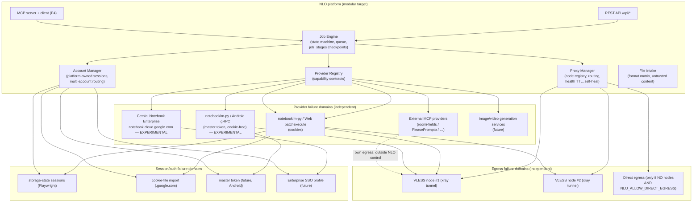

# NLO-P4-0 — Provider Ecosystem Research

Mission: **NLO-P4-0 — Universal Modular Architecture & NotebookLM Ecosystem Discovery**
Date accessed: **2026-11-15** (all URLs verified live on this date)
Scope: read-only research. No code, no runtime, no production change.
Status labels: `VERIFIED` (fetched and read today) · `PARTIAL` (metadata only) · `EXPERIMENTAL` · `UNSUPPORTED` · `UNKNOWN` (no evidence found).

---

## 1. Executive summary (what the ecosystem actually is)

1. **There is no official NotebookLM/Gemini Notebook programmatic API** (as of 2026-11-15). Every programmatic access — including NLO's own — rides on **undocumented internal web/Android RPCs** driven by browser cookies. Google renamed NotebookLM → **Gemini Notebook** on **2026-07-16** (official blog, VERIFIED) but the product, hosts, and internal RPC surface are unchanged.
2. The ecosystem splits into two families:
   - **Internal-RPC libraries** (no browser at request time; cookies only): `teng-lin/notebooklm-py` (Python), `jacob-bd/gemini-notebook-mcp-cli` (Python), `roomi-fields/notebooklm-mcp` (TS).
   - **Browser-automation servers** (drive a real Chrome per request): `PleasePrompto/notebooklm-mcp` (TS), `abdallah-nasir/notebooklm-mcp` (stale).
3. **NLO already has the strongest production posture in the ecosystem**: the only project with (a) a persistent job state machine with restart recovery, (b) a fail-closed verified-egress proxy layer (xray/VLESS), (c) hash-only API tokens + idempotency, (d) webhook outbox, (e) artifact archive + provenance, and (f) a deployable systemd service with CI. No other project in the sweep has any of (b)–(f).
4. The most operationally interesting competitor for NLO-P4 is **roomi-fields/notebooklm-mcp** (multi-account rotation + REST + MCP, TypeScript, actively maintained) — closest architectural cousin to the target state, but it _deliberately does not own a browser_ and has **no proxy support**.
5. **Gemini Notebook Enterprise** is a real, live product (`notebook.cloud.google.com`, project-qualified) but access is still **cookie/SSO-based, not a published REST API**. The most complete machine-verifiable Enterprise host evidence today comes from the jacob-bd CLI (live-verified with a `global` deployment, EXPERIMENTAL per its own README).

---

## 2. Google-side facts (VERIFIED 2026-11-15)

| Fact                                                                                                                                                                                                    | Evidence                                                                                                                                                                | Source                                                                                                                                              |
| ------------------------------------------------------------------------------------------------------------------------------------------------------------------------------------------------------- | ----------------------------------------------------------------------------------------------------------------------------------------------------------------------- | --------------------------------------------------------------------------------------------------------------------------------------------------- |
| Rebrand NotebookLM → Gemini Notebook, **2026-07-16**                                                                                                                                                    | "NotebookLM is now Gemini Notebook" — blog by Josh Woodward (VP, Google Labs, Gemini app & AI Studio); "same standalone product"; existing links redirect automatically | https://blog.google/innovation-and-ai/products/gemini-notebook/notebooklm-gemini-notebook/ (fetched 2026-11-15, `data/tmp-nlo-research-gblog.html`) |
| Product now "does more across the Google ecosystem, including inside the Gemini app and Google Search"; every notebook gets a "secure cloud computer" (code execution); >30M users, >600k organizations | same blog post                                                                                                                                                          | same                                                                                                                                                |
| Consumer product host is live: `https://notebook.google.com/` — "Gemini Notebook … Sign in … Audio Overviews / Video Overviews / Slide decks / Mind Maps" (HTTP 200)                                    | fetched 2026-11-15                                                                                                                                                      | `data/tmp-nlo-research-gem-note.html`                                                                                                               |
| `cloud.google.com/gemini/enterprise` is the Gemini Enterprise product page (universal work agent, per-person permissions, audit trail, budget caps) — **not** a NotebookLM Enterprise API page          | HTTP 200, fetched 2026-11-15                                                                                                                                            | `data/tmp-nlo-research-gem-prod.html`                                                                                                               |
| No public docs page found at `cloud.google.com/gemini/enterprise/docs/notebooks-overview` or `/notebooks/overview` (HTTP 404); no "notebooklm" GitHub org exists (`/repos/notebooklm` → Not Found)      | fetched 2026-11-15                                                                                                                                                      | GitHub API                                                                                                                                          |
| **No official REST/gRPC API is published for NotebookLM or Gemini Notebook** (consumer or Enterprise). All known programmatic access is undocumented-internal                                           | full sweep of §3                                                                                                                                                        | —                                                                                                                                                   |

**Implication for NLO:** the "Official API" column in any comparison matrix is `UNSUPPORTED` for every project. NLO's provider-abstraction choice (adapter per transport) is therefore the only future-proof shape: if Google ever ships an official API, it becomes a _new provider transport_, not a rewrite.

---

## 3. Project-by-project findings

Evidence per project: Date Accessed 2026-11-15 · Latest Verified Release · License · Maintenance Evidence (push date, release cadence, stars/forks).

### 3.1 `teng-lin/notebooklm-py` (primary reference for NLO's current worker)

- **Latest verified release: v0.8.6** (published 2026-10-29, GitHub releases API VERIFIED). NLO's `data/venv` currently runs **v0.8.5** (dist-info VERIFIED) — **one minor behind** upstream; the pin `notebooklm-py[browser,cookies]>=0.8.5,<0.9` in [`apps/server/python-requirements.txt`](apps/server/python-requirements.txt) _allows_ 0.8.6.
- 20,238★ / 2,690 forks · Python · MIT · pushed 2026-11-13 · 31 open issues. Most maintained project in the ecosystem.
- **Transports:** Web `batchexecute` RPC (default) **and** opt-in **Android gRPC backend** (bearer auth, `master_token.json`, short-lived mobile tokens; no browser-cookie dependency at request time). Both undocumented.
- **Auth:** 3 ways — interactive Playwright login; import cookies from a signed-in browser; **master-token auth** that mints fresh web cookies on demand (self-healing, server/CI model). Multi-account profiles (`notebooklm profile list/switch`).
- **Capabilities (all artifact types):** Audio (4 formats incl. deep-dive/brief/critique/debate, 3 lengths, 50+ languages, MP3/M4A), Video (4 formats, 8 styles, MP4), Slides (PDF/PPTX, per-slide revision), Infographic (PNG), Quiz/Flashcards (JSON/MD/HTML), Report (MD), Data table (CSV), Mind map (JSON, two kinds). Sources: URL, YouTube, PDF/text/MD/Word/EPUB/audio/video/images, Google Drive, pasted text. Plus notes, sharing, web/Drive research agents, usage introspection.
- **Distribution:** Python API, CLI, **MCP server** (stdio + remote/HTTP), **experimental REST server** (localhost FastAPI), agent skills (Claude Code / Codex).
- **Relevance to NLO:** this is the library NLO's Python worker calls. Its Android backend is the strongest signal that a _cookie-independent_ transport exists — candidate future provider transport for NLO-P4 (reduces browser/Playwright dependency). `later=True` deferred (asynchronous) generation (added 0.8.6) is the same "task id + poll" contract NLO already persists.
- v0.8.6 release notes (VERIFIED): deferred audio generation (#2506) and deferred Studio generation (#2519) with `later=True` — "Queue videos, reports…, quizzes, flashcards, infographics and slide decks"; "Scheduled jobs return `scheduled`".

### 3.2 `jacob-bd/gemini-notebook-mcp-cli` (package `notebooklm-mcp-cli`, bin `nlm`)

- **Latest verified release: v0.16.5** (2026-11-14, GitHub releases API VERIFIED). 6,517★ / 982 forks · Python · MIT · pushed 2026-11-14. Extremely high release cadence.
- **Transport:** internal web RPC (undocumented). No browser at request time.
- **Auth:** browser-profile cookie extraction (many Chromium families), manual cookie-file import (v0.16.5 fixed `.google.com` vs `.youtube.com` value selection for SID/HSID/SSID/APISID/SAPISID), **protected storage** (AES-style encryption with key in OS keystore — opt-in), named profiles for multiple Google accounts, headless `nlm auth refresh` (cron/CI), auto CSRF/session refresh with failure budget.
- **Enterprise:** README states "Personal/consumer accounts are tested regularly. **Gemini Notebook Enterprise support is experimental**"; documented host `notebook.cloud.google.com` **live-verified with a project-qualified `global` deployment**; configured via `NOTEBOOKLM_BASE_URL` + `NOTEBOOKLM_PROJECT_ID` (+ optional `NOTEBOOKLM_LOCATION`: global/us/eu) + an Enterprise SSO login profile. Older hosts: `notebooklm.cloud.google.com`, `vertexaisearch.cloud.google.com`. This is the most concrete machine-verified Enterprise evidence found in the sweep.
- **MCP:** 55 tools; CLI (`nlm`), pipelines, batch, cross-notebook query, usage metering (`nlm usage`), doctor, setup wizard for many AI clients.
- **Relevance to NLO:** the best public reference for (a) Enterprise host/config facts, (b) credential _encryption-at-rest_ with OS-keychain keys (NLO has AES-256-GCM vault — comparable; keystore integration is an optional NLO-P4+ idea), (c) cookie-file import with domain-aware value selection (NLO already imports `.google.com` cookies — the v0.16.5 bug/fix is a cautionary pattern worth documenting in NLO's auth docs).

### 3.3 `abdallah-nasir/notebooklm-mcp` (mission-named; **stale**)

- 0★ · TypeScript · MIT · last push **2026-06-14** (~5 months before access date) · no significant release cadence evidence. Maintenance: **PARTIAL → effectively dormant** (not deleted, not updated since June 2026).
- npm `notebooklm-mcp` latest is **2.0.0**, published 2026-05-01 — **and the npm package's `repository` field points to `github.com/PleasePrompto/notebooklm-mcp`** (npm registry VERIFIED). The `abdallah-nasir` repo appears to be a mirror/fork of PleasePrompto's server; its README (fetched) matches the PleasePrompto v2 line: Patchright (stealth) Chrome, stdio + Streamable-HTTP transports, multi-account via `--account <slug>` sub-trees, tool profiles (minimal/standard/full), DOM citations, provenance envelope.
- **Relevance to NLO:** low. Included for completeness because the mission named it. Browser-automation family; no proxy; no job persistence.

### 3.4 `PleasePrompto/notebooklm-mcp` (npm `notebooklm-mcp` — the package the mission's "abdallah-nasir" repo actually mirrors)

- 3,447★ · TypeScript · MIT · pushed 2026-09-10 · npm v2.0.0 (2026-05-01).
- **Browser-automation family:** drives real Chrome via Patchright (persistent profile per account; login once, then headless). Multi-account by `--account <slug>` (separate cookie/profile trees; _no encrypted credential store_ — README states isolation is purely by profile directory).
- Transports: **stdio + Streamable-HTTP** (`POST /mcp`, `GET /mcp` SSE, `DELETE /mcp`, `/healthz`; default bind 127.0.0.1). Tool profiles + per-tool disable; DOM citation extraction (`inline`/`footnotes`/`json`); explicit **untrusted-input / provenance** tagging (`_provenance` envelope + AI marker) — a good precedent for NLO's "untrusted-content rule".
- Audio: `generate_audio` + `download_audio` (latest audio only). No proxy support found; concurrency = `MAX_SESSIONS` (default 10 browser sessions).
- **Relevance to NLO:** proves Streamable-HTTP MCP servers are a viable _client-side_ pattern; its provenance envelope is a model for NLO's future MCP server responses.

### 3.5 `roomi-fields/notebooklm-mcp` (closest architectural cousin)

- 241★ · TypeScript · MIT · pushed 2026-11-13 · README describes "Google Gemini Notebook (formerly NotebookLM) over **MCP + a local HTTP REST API**. Citation-backed Q&A, full Studio generation, chat history, **multi-account rotation**. For Claude Code, Codex, Cursor, n8n, Zapier, Make."
- **Multi-account rotation with automatic re-authentication** ("picks up when a daily quota runs out"); recognizes both `notebook.google.com` and Workspace/Enterprise hosts; v4.6.0 (2026-11-06) added "**retry a failed generation without losing its id**" + UTCP internal transport; session store no longer reachable via HTTP after a v4.2.0 security fix; **deliberately does not own a browser** (session bound to external browser/cookie source).
- **No proxy support found** in README (no proxy keyword hits). No published job-retry/backoff policy beyond the single retry fix.
- **Relevance to NLO:** validates the "MCP + REST + multi-account" product shape NLO-P4 targets; its "retry without losing id" is the same contract NLO already implements at job-stages level (external_operation_id preserved across restart).

### 3.6 Other sweep entries (metadata only, PARTIAL)

| Repo                                      | ★   | Lang | License | Last push | Note                                                                   |
| ----------------------------------------- | --- | ---- | ------- | --------- | ---------------------------------------------------------------------- |
| `claude-world/notebooklm-skill`           | 501 | —    | —       | —         | Agent skill wrapper (usage pattern, not a runtime)                     |
| `SourceWeft/SourceWeft`                   | 487 | —    | —       | —         | Research tooling built on NotebookLM                                   |
| `Pantheon-Security/notebooklm-mcp-secure` | 88  | —    | —       | —         | "17 security layers" positioning — credential-handling marketing trend |
| `khengyun` (repo)                         | 82  | —    | —       | —         | smaller wrapper                                                        |
| `WenyuChiou/research-hub`                 | 68  | —    | —       | —         | smaller wrapper                                                        |
| `alfredang` (repo)                        | 62  | —    | —       | —         | smaller wrapper                                                        |
| `m4yk3ldev/notebooklm-mcp`                | 23  | —    | —       | —         | 27 tools                                                               |
| plus ~7 more 20–45★ wrappers              | —   | —    | —       | —         | long tail                                                              |

(Evidence: GitHub search API `q=notebooklm+mcp&sort=stars`, fetched 2026-11-15.)

---

## 4. Capability comparison matrix

Labels: `VERIFIED` (stated in fetched README/source today) · `PARTIAL` · `EXPERIMENTAL` · `UNSUPPORTED` (stated absent) · `UNKNOWN` (no evidence).

| Dimension                                   | **NLO (this repo)**                                                           | teng-lin/notebooklm-py                                       | jacob-bd/gemini-notebook-mcp-cli                                          | PleasePrompto/notebooklm-mcp                                  | roomi-fields/notebooklm-mcp                   | abdallah-nasir/notebooklm-mcp                                 |
| ------------------------------------------- | ----------------------------------------------------------------------------- | ------------------------------------------------------------ | ------------------------------------------------------------------------- | ------------------------------------------------------------- | --------------------------------------------- | ------------------------------------------------------------- |
| Maintained (2026-11-15)                     | VERIFIED (CI green, deployed 2026-11-14)                                      | VERIFIED (pushed 2026-11-13)                                 | VERIFIED (pushed 2026-11-14)                                              | PARTIAL (pushed 2026-09-10)                                   | VERIFIED (pushed 2026-11-13)                  | PARTIAL (pushed 2026-06-14, stale)                            |
| License                                     | MIT (repo)                                                                    | MIT                                                          | MIT                                                                       | MIT                                                           | MIT                                           | MIT                                                           |
| Language                                    | TypeScript + Python worker                                                    | Python                                                       | Python                                                                    | TypeScript                                                    | TypeScript                                    | TypeScript                                                    |
| MCP **server**                              | NOT_IMPLEMENTED (target P4)                                                   | VERIFIED (stdio + remote)                                    | VERIFIED (55 tools)                                                       | VERIFIED (stdio + Streamable-HTTP)                            | VERIFIED                                      | VERIFIED                                                      |
| MCP **client**                              | NOT_IMPLEMENTED (target P4)                                                   | VERIFIED (its own MCP as client tools)                       | VERIFIED                                                                  | n/a (it is the server)                                        | VERIFIED                                      | n/a                                                           |
| REST API                                    | **VERIFIED** (59 routes, token auth, idempotency)                             | EXPERIMENTAL (localhost FastAPI)                             | UNKNOWN (MCP + CLI, no REST server stated)                                | VERIFIED (Streamable-HTTP MCP over HTTP)                      | VERIFIED ("local HTTP REST API")              | VERIFIED (Streamable-HTTP MCP over HTTP)                      |
| SDK/library                                 | PARTIAL (worker protocol, not public)                                         | VERIFIED (async Python client)                               | VERIFIED (CLI + MCP; lib internal)                                        | UNKNOWN                                                       | UNKNOWN                                       | UNKNOWN                                                       |
| Browser automation at request time          | PARTIAL (Playwright only for login; RPC at request time)                      | PARTIAL (login only; Android backend avoids it)              | PARTIAL (login/refresh only)                                              | VERIFIED (Chrome per request)                                 | VERIFIED (no own browser; external session)   | VERIFIED (Chrome per request)                                 |
| Official Google API                         | UNSUPPORTED (none exists)                                                     | UNSUPPORTED                                                  | UNSUPPORTED                                                               | UNSUPPORTED                                                   | UNSUPPORTED                                   | UNSUPPORTED                                                   |
| Auth model                                  | VERIFIED (storage-state sessions, 0600, 10-min verified TTL, reauth flow)     | VERIFIED (browser login / cookie import / **master token**)  | VERIFIED (profile cookies, manual import, **encrypted keystore storage**) | VERIFIED (persistent Chrome profile)                          | VERIFIED (external session, auto-reauth)      | VERIFIED (persistent Chrome profile)                          |
| Multi-account                               | VERIFIED (accounts table, per-account sessions)                               | VERIFIED (profiles)                                          | VERIFIED (named profiles)                                                 | VERIFIED (`--account` sub-trees)                              | VERIFIED (**rotation on quota**)              | VERIFIED (`--account` sub-trees)                              |
| Persistent session                          | VERIFIED (Playwright storage-state per account, atomic writes)                | VERIFIED (storage + master token)                            | VERIFIED (saved profiles, protected mode)                                 | VERIFIED (Chrome profile dir)                                 | VERIFIED (session store)                      | VERIFIED (Chrome profile dir)                                 |
| Proxy / egress control                      | **VERIFIED** (xray/VLESS, fail-closed, staged health, SSRF allowlist)         | UNKNOWN (no proxy system found)                              | UNKNOWN (env-var transport; no proxy system found)                        | UNSUPPORTED (no proxy found)                                  | UNSUPPORTED (no proxy found)                  | UNSUPPORTED (no proxy found)                                  |
| Audio generation                            | VERIFIED (live-verified 2026-11-06; resume-never-resubmit)                    | VERIFIED (incl. deferred `later=True` in 0.8.6)              | VERIFIED (studio create)                                                  | PARTIAL (generate/download latest)                            | VERIFIED (full Studio)                        | PARTIAL (generate/download latest)                            |
| Other artifacts (video/slides/infographic…) | PARTIAL (audio + text answer today; video/infographic = P4 target)            | VERIFIED (all types)                                         | VERIFIED (studio + interactive reports)                                   | PARTIAL (audio focus)                                         | VERIFIED (full Studio)                        | PARTIAL (audio focus)                                         |
| Artifact download                           | VERIFIED (archive, sha256, ETag, MP3 transcode)                               | VERIFIED (all types, batch)                                  | VERIFIED (`download all`)                                                 | PARTIAL (audio)                                               | VERIFIED                                      | PARTIAL (audio)                                               |
| Retry policy                                | VERIFIED (retryable-by-failure-class, full-jitter backoff, attempts recorded) | PARTIAL (internal; not a policy system)                      | PARTIAL (CSRF refresh; failure budget)                                    | PARTIAL (timeouts only)                                       | PARTIAL (retry-without-losing-id, v4.6.0)     | PARTIAL (timeouts only)                                       |
| Job persistence / restart recovery          | **VERIFIED** (job_stages checkpoints, external-op-id preserved)               | UNSUPPORTED (in-process only)                                | UNSUPPORTED (in-process only)                                             | UNSUPPORTED (in-process only)                                 | PARTIAL (session store; no job engine stated) | UNSUPPORTED (in-process only)                                 |
| Concurrency model                           | VERIFIED (in-process queue; single worker; per-job Python spawns)             | PARTIAL (async client)                                       | PARTIAL                                                                   | PARTIAL (`MAX_SESSIONS=10`)                                   | PARTIAL                                       | PARTIAL (`MAX_SESSIONS=10`)                                   |
| API tokens / authn for _consumers_          | VERIFIED (nlo_ tokens, scopes, idempotency, audit log)                        | UNSUPPORTED (single-user tool)                               | UNSUPPORTED                                                               | PARTIAL (HTTP bind only)                                      | UNKNOWN                                       | PARTIAL (HTTP bind only)                                      |
| Webhooks / outbox                           | VERIFIED (outbox + HMAC + dead-letter)                                        | UNSUPPORTED                                                  | UNSUPPORTED                                                               | UNSUPPORTED                                                   | UNKNOWN                                       | UNSUPPORTED                                                   |
| Secrets hygiene                             | VERIFIED (vault AES-256-GCM 0600, redaction, no secrets in git)               | PARTIAL (master token = full-account credential, plain file) | VERIFIED (opt-in keystore encryption)                                     | PARTIAL (plain profile dir, stated)                           | PARTIAL (session store; v4.2.0 hardened)      | PARTIAL (plain profile dir, stated)                           |
| Production suitability                      | VERIFIED (systemd service, CI, deploy script, live-verified)                  | PARTIAL (library-grade; "use at your own risk")              | PARTIAL (personal/CLI-grade; enterprise EXPERIMENTAL)                     | PARTIAL (desktop/HTTP-grade)                                  | PARTIAL (self-hosted)                         | PARTIAL (desktop/HTTP-grade)                                  |
| Security risk                               | PARTIAL (loopback-only default; non-loopback needs proxy — documented)        | PARTIAL (undocumented APIs; master token high-value)         | PARTIAL (undocumented APIs; cookie handling hardened)                     | PARTIAL (Chrome profile = full session; no encryption stated) | PARTIAL (session-bound; external browser)     | PARTIAL (Chrome profile = full session; no encryption stated) |

---

## 5. Real provider independence & failure-domain analysis

NLO today has exactly **one** provider (NotebookLM via `notebooklm-py` in a Python worker), one session store, one egress mechanism. The target state must treat _content engines_, _connection methods_, _accounts_, and _proxies_ as independent failure domains.

Failure-domain properties (design constraints, evidence-backed):

1. **A dead proxy node must not lose the job.** NLO already persists `external_operation_id` the moment an external task exists ([`apps/server/src/domain/jobs.repo.ts`](apps/server/src/domain/jobs.repo.ts), `patchOperationIds`) and resumes from it after restart. The same invariant must hold across _provider_ failover: a job that has a recorded external op is never blindly resubmitted on another provider/account (UNKNOWN_EXTERNAL_STATE rule).
2. **A dead account must not stop the platform.** Account eligibility is already decoupled via session verification TTL (10 min) and the `WAITING_FOR_ACCOUNT` state. Multi-account _rotation on quota_ (roomi-fields) is a pattern to adopt at the routing layer, not inside a provider.
3. **One provider's internal API breaking must not break the platform.** Every provider transport (web batchexecute, Android gRPC, Enterprise host, MCP tool-calling) is an _adapter_ behind the same capability contract; conformance tests per adapter (see ADR-001).
4. **Egress and provider are orthogonal.** A VLESS tunnel is a _network_ property, a provider is a _content_ property; NLO's current coupling (tunnel env var passed into the Python worker) must become a first-class routing decision in the target architecture.

---

## 6. What NLO should steal / adopt (with evidence)

| Idea                                                                                        | Source (evidence)                                           | Fit for NLO                                                                                                                                                  |
| ------------------------------------------------------------------------------------------- | ----------------------------------------------------------- | ------------------------------------------------------------------------------------------------------------------------------------------------------------ |
| Cookie-free transport (Android gRPC + master token)                                         | notebooklm-py README + v0.8.x backend guide                 | High — removes Playwright/Chromium from the _request path_; master token is a _higher-value_ secret than cookies (dedicated account recommended by upstream) |
| Deferred/asynchronous generation (`later=True`, poll task id)                               | notebooklm-py v0.8.6 release notes                          | NLO already does this (external task id + poll) — contract parity confirmed                                                                                  |
| Multi-account rotation on quota exhaustion                                                  | roomi-fields README + `deployment/docs/11-MULTI-ACCOUNT.md` | High — routing-layer policy, fits Account Manager                                                                                                            |
| Retry-without-losing-id                                                                     | roomi-fields v4.6.0 changelog                               | NLO already stronger (checkpointed job_stages) — keep, document as differentiator                                                                            |
| Provenance + untrusted-input envelope on every answer                                       | PleasePrompto README (`_provenance`, AI marker)             | High — adopt verbatim for NLO MCP server + API responses                                                                                                     |
| Streamable-HTTP MCP transport (POST/GET/DELETE `/mcp`, `/healthz`)                          | PleasePrompto README                                        | High — reference implementation for NLO's MCP server                                                                                                         |
| Enterprise host + config model (`NOTEBOOKLM_BASE_URL`/`PROJECT_ID`/`LOCATION`, SSO profile) | jacob-bd README (experimental, live-verified `global`)      | Medium — design the _provider-connection_ contract to hold these fields today, implement when a customer has an Enterprise subscription                      |
| Encrypted-at-rest credentials with OS-keystore key                                          | jacob-bd README (opt-in protected storage)                  | Low-medium — NLO's AES-256-GCM vault already covers the need; keystore is a convenience, not a requirement                                                   |
| Cookie-import domain awareness (prefer `.google.com` values for SID-family)                 | jacob-bd v0.16.5 release notes                              | Medium — document as a known failure mode in NLO session import; add to intake validation checklist                                                          |
| No-browser MCP servers ("does not own a browser")                                           | roomi-fields README                                         | Confirms NLO's own architecture (RPC at request time, browser only for login) is the industry-leading posture                                                |

## 7. Risks / open questions (honest, unresolved)

1. **No official API anywhere in the ecosystem** → all providers are breakable at Google's discretion; conformance suites + provider pinning + graceful degradation are the only mitigations. (VERIFIED across all 6 projects.)
2. **Enterprise access model is not published** — the `notebook.cloud.google.com` facts come from a single third-party project (EXPERIMENTAL). NLO must not claim Enterprise support until it verifies against its own (or a customer's) GCP project. **Status: NOT_TESTED for NLO.**
3. **Rate-limit semantics differ per account tier** (notebooklm-py documents per-tier notebook/source/studio limits; jacob-bd documents rolling ~5h window + weekly compute cap). NLO's retry policy must consume per-account limits, not global constants — **not yet implemented; design item for P4.**
4. **The "notebooklm-mcp" npm name collision** (abdallah-nasir repo vs PleasePrompto package) shows the ecosystem's naming churn — pin by repo + version, never by name.
